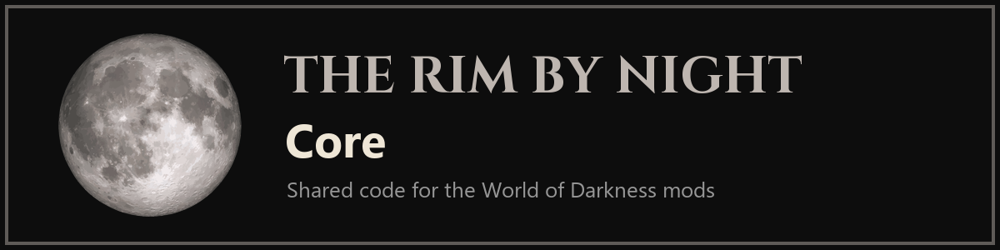
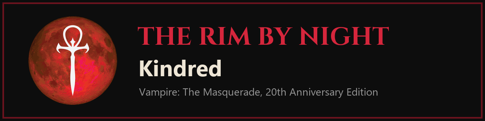
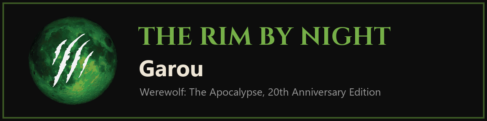
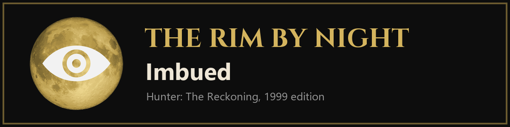
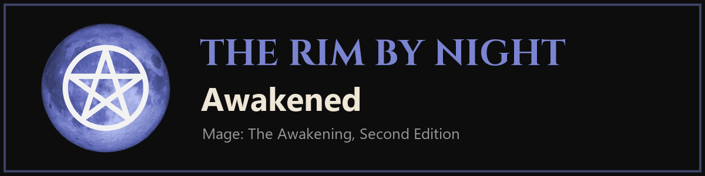
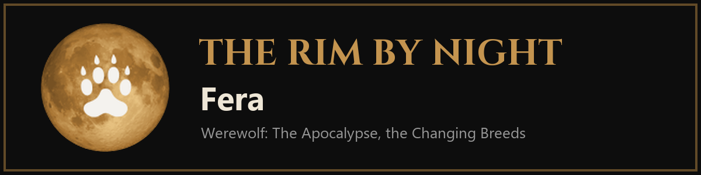

# The Rim by Night

The World of Darkness in RimWorld. Vampires feed on your colonists, werewolves fight for the land,
some ordinary people wake up one night able to see monsters for what they are, and a few others
learn to work magic.

Every mod in the series plays on its own, and they all know about each other. Load one, two or all
of them in the same game. Each needs Harmony and
[The Rim by Night: Core](https://steamcommunity.com/sharedfiles/filedetails/?id=3827268537) loaded
before it. All of them are in the
[Workshop collection](https://steamcommunity.com/sharedfiles/filedetails/?id=3841910475).

| | |
|---|---|
|  **[Kindred](kindred/README.md)**: Vampire: The Masquerade, on the 20th Anniversary Edition rules. Thirteen clans, the Disciplines, Humanity and frenzy, and the courts of the Camarilla, the Sabbat and the Anarchs. |  **[Garou](garou/README.md)**: Werewolf: The Apocalypse, on the 20th Anniversary Edition rules. Five forms, tribes and auspices, Gifts and rites, caerns, the Umbra and the Wyrm. |
|  **[Imbued](imbued/README.md)**: Hunter: The Reckoning, on the 1999 rules. Creeds, Virtues and Edges, monster cases to work like a detective, and a colony that sees through every mask. |  **[Awakened](awakened/README.md)**: Mage: The Awakening, second edition. The five Paths, the ten Arcana, a spell builder, Paradox, and the Consilium. In beta. |

| | |
|---|---|
|  **[Fera](fera/README.md)**: the Changing Breeds of Werewolf: The Apocalypse, a DLC for Garou. Seven more shifter breeds: Corax, Ratkin, Ananasi, Gurahl, Mokolé, Kitsune and Nuwisha. **Not released yet.** | **[Core](core/README.md)**: the shared code the series runs on. Its pages list what every mod shares: the grimoire's dice, towns, boons, Backgrounds, gatherings, the tavern, beasts and the smarter enemies. |

Each mod's section ends with **Reference** pages generated from the game files: every event and what
it means, every mission, power, spell, rite, item, building, condition, mood, setting and alert.

## Playing them together

- Septs and courts feud over the same ground.
- Hunters can find out who is a vampire or a werewolf, in your colony and in towns on the world map.
- Garou get Gifts against the undead, and a vampire who falls below Humanity 7 carries the Wyrm's taint.
- One in-game grimoire covers every mod you have loaded, so you don't need to know the tabletop games.

See [Kindred and Garou](garou/Kindred-and-Garou.md), [Werewolves](kindred/Werewolves.md) and
[Living with monsters](imbued/Living-with-Monsters.md) for what changes when they meet.

---

This is not official World of Darkness material. Portions of the materials are the copyrights
and trademarks of Paradox Interactive AB, and are used with permission. All rights reserved. For
more information please visit worldofdarkness.com.
