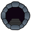
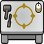
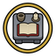

# Every building

Every building, piece of furniture and plant this mod adds.

## Buildings and furniture

| | Name | Value | What it is |
|---|---|---|---|
|  | **Avernian Gate** |  | A gate to the Underworld, cold and dark. Death magic is stronger near it, and every day a ghost climbs out. |
|  | **Cut-out space** |  | Nothing. This piece of the world has been set aside, and there is no way into it. |
|  | **Enchanting table** |  | A worktable marked with circles and the names of the Watchtowers. Standing in a Sanctum, it lets a mage with Prime 4 set a spell into an item, which anyone can use afterwards. |
|  | **Ghost gate** |  | A doorway of grey mist. Whoever walks through it becomes a shade, and walking through again brings them back. |
|  | **Ghost of a wall** |  | A faint picture of something solid that a spell has made insubstantial. Anything can pass through. |
|  | **Invisible rune** |  | A message written in light only mages can see. |
|  | **Iris** |  | A hole in the Gauntlet. Whoever steps on it crosses into the Shadow, and its twin on the far side brings them back. |
|  | **Portal** |  | A fold in space. Whoever steps on it comes out of its twin, here or somewhere else entirely. |
|  | **Sanctum focus** |  | An altar, a desk of tools and a circle on the floor: the heart of a mage's Sanctum. The room it stands in becomes the Sanctum of the mages assigned to it, rated by how impressive and how closed off it is. |
|  | **Shadow figure** |  | A shadow standing up like a person. From a distance it could be anyone. |
|  | **Spell light** |  | Light a spell pours into this place, bright as a sun lamp. |
|  | **Spell power** |  | Power a spell feeds into the conduit here. Nobody can see where it comes from. |
|  | **Spell runes** |  | Symbols drawn on the ground for a spell. While they last, so does the spell; scuff them out and it ends. |

[← Awakened contents](README.md) · [The Rim by Night](../README.md)

---

This is not official World of Darkness material. Portions of the materials are the copyrights
and trademarks of Paradox Interactive AB, and are used with permission. All rights reserved. For
more information please visit worldofdarkness.com.
