# Every item

Every item, weapon and piece of apparel this mod adds. Value is the base market value in silver.

## Weapons

| | Name | Damage | Value | What it is |
|---|---|---|---|---|
| 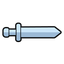 | **Platonic blade** | 23 melee | 0 | A sword of pure Mana, the idea of a sword more than a sword. It's gone when the spell that holds it ends. |
|  | **Platonic tool** | 9 melee | 0 | A hammer, a needle and a plane at once: the idea of a tool. Whoever holds it works faster at everything. It's gone when the spell that holds it ends. |
| 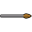 | **The Thunder Spear** | 23 melee | 2500 | A bronze spearhead on a blackened shaft. Storms follow whoever carries it to a fight. A Obrimos Artifact, rating 5. |

## Apparel

| | Name | Value | What it is |
|---|---|---|---|
|  | **Atlantean shard** | 2500 | A sliver of the Supernal crystal the old Atlanteans built with. Worn at the throat by a mage, it gives one more dot in the Arcanum it still holds. |
| 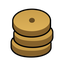 | **Mana-cell ring** | 900 | A silver ring set with a cloudy stone that holds three points of Mana. A mage who wears it can draw on them when their own Mana runs dry, and fill it again standing in a Hallow. Worn on a cord at the belt. |

## Items

| | Name | Value | What it is |
|---|---|---|---|
| 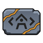 | **Atlantean tablet** | 2000 | A slab of orichalcum-veined stone cut with the High Speech, said to come from before the Fall. The rotes on it still work. A mage who has the Arcanum can learn them, an Experience each, or cast them from the stone as slow rituals. |
| 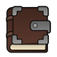 | **Blank grimoire** | 60 | A heavy book of good paper, bound to last, waiting for a mage to write rotes into it with Scribe Grimoire. It holds up to ten. |
| 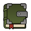 | **Daimonomikon** | 600 | A Legacy's book: its teachings, its exercises and the rite that binds a mage's soul to its way. A mage of the right Path, with two dots in the Legacy's Arcanum and the skill it asks for, joins it after reading for eight hours. To anyone else it reads as nonsense. |
|  | **Dull crystal shard** | 200 | A finger-long sliver of clouded crystal, too regular to be natural. Study it at an enchanting table or a research bench to find out what it is. A mage with Prime sight open knows it at a look. |
|  | **Ectoplasm** | 0 | Pale, cold ghost-stuff pulled out of a body or a mage. A Death spell can shape it into a simple thing for a while. |
|  | **Ectoplasm slime** |  | Pale slime that clings to the feet. It thins out and fades in a few days. |
| 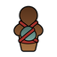 | **Essence fetish** | 150 | A small thing with a spirit bound inside it. A mage who holds it can draw on the spirit's Essence as Mana, until it's empty. |
| 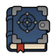 | **Grimoire** | 400 | A mage's book of rotes, written in the High Speech and full of diagrams. A mage who has the Arcanum can learn its rotes from it, an Experience each, or cast them straight from the page as slow rituals while it's in their pack or their room. To anyone else it reads as nonsense. |
| 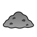 | **Hallow ash** | 12 | Grey ash that never quite cools. A mage can draw the Mana out of it; anyone else would sweep it up. |
| 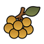 | **Hallow fruit** | 12 | Small golden berries that never spoil. Eaten, they give a mage a Mana each; anyone else finds them sweet. |
| 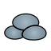 | **Hallow stone** | 12 | A smooth pebble, cool and faintly heavy for its size. To a mage it's a mouthful of Mana; to anyone else it's a nice stone. |
|  | **Hallow water** | 12 | A jar of spring water that stays clear and warm. A mage drinks the Mana in it; anyone else gets a drink of water. |
|  | **Mage's coin** |  | A coin struck for a mage, heavy and worn smooth. Carried, it is a Path tool for spells of making, wealth and Matter or Fate: one more die. |
|  | **Mage's cup** |  | A small cup that has never held anything but water and blood. Carried, it is a Path tool for spells of healing, Life and the senses: one more die. |
|  | **Mage's mirror** |  | A hand mirror that shows the holder a little too clearly. Carried, it is a Path tool for spells a mage casts on herself: one more die. |
| 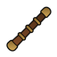 | **Mage's rod** |  | A short rod, carved and capped, the kind of thing a person points with. Carried, it is a Path tool for spells that command or control: one more die. |
| 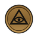 | **Order token** |  | A badge, mask, pen or sigil that marks an Order's member. Carried by one of that Order, it is a tool for every spell the Order teaches: one more die. |
|  | **Platonic gem** | 12 | A flawless gem of solid Mana. A mage draws the Mana out of it as from tass. It's gone when the spell that holds it ends. |
|  | **Seer's ledger** | 2000 | A Seer of the Throne's working ledger: who was watched, what was done to them, and the rotes that did it. A mage who has the Arcanum can learn its rotes, an Experience each, or cast them from the page as slow rituals. |
|  | **Seer-glass** | 1100 | A round lens of black glass in a brass ring. Held to the eye, it shows a place far away as if through a window. A Mastigos Artifact, rating 2. |
|  | **Shadowstuff** | 0 | Darkness made solid by a Death spell. It's light and cold, and gone when the spell ends. |
| 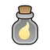 | **Soul** | 0 | A soul torn out of its body, a faint light that won't stay still. Left alone it drifts home to its body within a day. Anyone can let it go; a mage can eat it for Mana, at a cost to their Wisdom. |
| 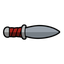 | **The Black Mirror Knife** | 2000 | An obsidian blade that shows a reflection a moment late. Left unused for a week, it cuts the hand that holds it. A Moros Artifact, rating 4. |
| 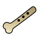 | **The Bone Flute** | 1500 | A flute cut from a long bone, three holes, no mouthpiece. It plays itself at dusk. A Thyrsus Artifact, rating 3. |
| 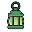 | **The Ferryman's Lamp** | 1500 | A ship's lamp gone green with age. It glows when a ghost is near. A Moros Artifact, rating 3. |
|  | **The Folded Map** | 2000 | A map folded so many times it is mostly creases. Opened, it shows the place its holder is most afraid of. A Mastigos Artifact, rating 4. |
|  | **The Gambler's Last Coin** | 1500 | An old coin worn smooth on both faces. Its last owner bet everything on it and won, once. A Acanthus Artifact, rating 3. |
| 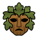 | **The Green Man's Mask** | 2000 | A carved wooden mask with leaves growing from its brow. Whoever wears it smells of rain. A Thyrsus Artifact, rating 4. |
| 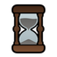 | **The Hourglass of Ash** | 2500 | A small hourglass full of grey ash that runs as fast or as slow as it likes. A Acanthus Artifact, rating 5. |
|  | **The Iron Crown** | 2500 | A plain iron circlet, cold even in summer. Whoever keeps it dreams of ruling. A Mastigos Artifact, rating 5. |
| 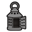 | **The Lantern of Nowhere** | 1500 | A tin lantern with no wick. It lights itself when someone is watching a door. A Mastigos Artifact, rating 3. |
| 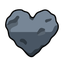 | **The Leaden Heart** | 2000 | A lump of lead shaped like a heart, heavier than it should be. Gold left near it turns grey. A Moros Artifact, rating 4. |
|  | **The Lens of First Light** | 2000 | A ground-glass lens that holds a little light even in the dark. A lie told in front of it burns into the air. A Obrimos Artifact, rating 4. |
| 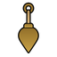 | **The Mason's Plumb** | 1500 | A brass plumb bob on a waxed cord. It swings toward the weakest wall in the room. A Moros Artifact, rating 3. |
|  | **The Midwife's Needle** | 2000 | A curved silver needle threaded with red silk. It warms when someone nearby is dying. A Thyrsus Artifact, rating 4. |
| 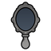 | **The Mirror That Remembers** | 2000 | A hand mirror in a tarnished silver frame. Hung on a wall, it shows the last death that happened in the room, and nobody likes to be the one who looks. A Acanthus Artifact, rating 4. |
| 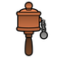 | **The Prayer Wheel** | 1500 | A hand prayer wheel of beaten copper. It spins on its own when someone casts a spell nearby. A Obrimos Artifact, rating 3. |
|  | **The Seraph's Feather** | 2000 | A long white feather that never gets dirty. It lifts its holder when they fall. A Obrimos Artifact, rating 4. |
|  | **The Silver Tongue** | 1500 | A small silver tongue on a chain, the kind left at old shrines. At night it whispers to whoever wears it. A Mastigos Artifact, rating 3. |
| 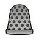 | **The Witch-Queen's Thimble** | 1500 | A silver thimble with a needle-sharp rim. It pricks whoever breaks a promise near it. A Acanthus Artifact, rating 3. |
| 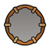 | **The Wolf-Hide Drum** | 2500 | A frame drum covered in grey wolf hide. It beats by itself when spirits are near. A Thyrsus Artifact, rating 5. |
| 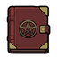 | **Tome** | 1500 | A rare book of lost rotes, a few chapters long. A mage studies it a chapter at a time in a Library, and each chapter teaches for good. Every tome is dangerous to read. |

[← Awakened contents](README.md) · [The Rim by Night](../README.md)

---

This is not official World of Darkness material. Portions of the materials are the copyrights
and trademarks of Paradox Interactive AB, and are used with permission. All rights reserved. For
more information please visit worldofdarkness.com.
