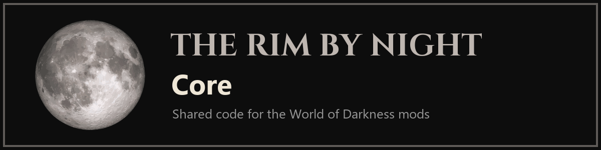

# The Rim by Night: Core

Core is the shared code every mod in the series runs on. It adds nothing to a game on its own, but
everything here shows up in any game with one of the mods loaded: the grimoire, the dice and the roll
log, the talk window, towns, the raider who got away, the shared settings window, the sworn home, boons
and favours, Backgrounds, gatherings, the tavern, beasts and familiars, and the smarter enemies.

Load it after Harmony and before the other mods. Each mod's own pages explain these systems in that
mod's words; the pages below list everything Core itself defines.

## Reference

Every event, power, item and the rest, listed in full from the game files.

| Page |
|---|
| [Every event](Reference-Events.md) |
| [Every mission and quest](Reference-Missions.md) |
| [Every item](Reference-Items.md) |
| [Every building](Reference-Buildings.md) |
| [People, factions and creatures](Reference-People.md) |
| [Every condition](Reference-Conditions.md) |
| [Every thought and mood](Reference-Thoughts.md) |
| [Mental states and inspirations](Reference-Minds.md) |
| [Every setting](Reference-Settings.md) |
| [Every alert](Reference-Alerts.md) |
| [What changed](Reference-Changes.md) |
| [Everything else](Reference-Other.md) |

---

This is not official World of Darkness material. Portions of the materials are the copyrights
and trademarks of Paradox Interactive AB, and are used with permission. All rights reserved. For
more information please visit worldofdarkness.com.
