# Every item

Every item, weapon and piece of apparel this mod adds. Value is the base market value in silver.

## Weapons

| | Name | Damage | Value | What it is |
|---|---|---|---|---|
|  | **Aspergillum** | 14 melee |  | A priest's holy-water sprinkler, made heavy enough to break bones. The hunting orders arm their Inquisitors with them. Swung by someone with True Faith, every blow burns a vampire the way a holy symbol does. Without faith, it's only a mace. |
| 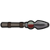 | **Bloodletter** | 15 melee |  | A short spear with a hollow steel point and a blood groove running back into a glass chamber. Every wound drains a vampire's blood pool and bleeds a ghoul's vitae out with it. To anyone else it's a poor spear. |
| 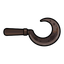 | **Burial sickle** | 11 melee |  | An old iron sickle with a tight curve, the kind once laid over the necks of the buried dead. It hooks the neck of the afflicted for extra damage, and does more to a corpse-risen shambler. Otherwise it's a weak sickle. |
|  | **Chalk-dust bomb** | 5 burst, range 12.9 |  | A paper-wrapped bundle tied with string, used up when thrown. It bursts into white chalk, and anyone hidden by a power is coated and can be seen and shot. It hurts nobody. |
| 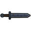 | **Cold iron sword** | 15 melee |  | A straight, plain sword of dark unpolished iron, the hammer marks still on the blade. It bites hard into spirits and the afflicted, and a hit stops a necromancer raising the dead for a while. Brittle, and worse than steel against anyone else. |
| 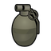 | **Dog whistle grenade** | 5 burst, range 12.9 |  | An olive grenade with a slotted whistle built into the top, used up when thrown. The screech stuns anyone in Lupus or Hispo and shakes every other Garou. People hear nothing. |
| 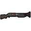 | **Dragon's breath shotgun** | 6 , range 7.9 |  | A pump shotgun with a scorched barrel and a flared muzzle, firing shells of burning metal. Very short range, a cone of flame, and the barrel needs time to cool. |
| 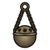 | **Exorcist's censer** | 1 burst, range 4.9 |  | A pierced brass censer on short chains, swung at close range. Its smoke pulls a bane out of a possessed person alive, and hurts a fomor over time. It does nothing to anyone else. |
| 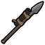 | **Fire lance** | 6 flame, range 5.9 |  | A spear with a tube of powder and pitch lashed behind the head. Lit, it spits flame a few steps and sets whatever it reaches on fire, and once it burns out it's still a spear. Vampires fear fire more than anything, and hunters know it. |
| 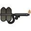 | **Flamethrower** | 7 melee |  | A short wand with a lit pilot, on a hose from a pair of heavy tanks that slow whoever carries them. It sets everything in front of it alight, allies included. |
|  | **Flare gun** | 8 flame, range 19.9 |  | A stubby orange pistol with a wide barrel and one cartridge at a time. The flare sets its target alight and lights up the ground around it, and reloading is slow. |
| 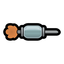 | **Frenzy dart gun** | 1 burst, range 25.9 |  | A long pneumatic dart gun with a glass sedative vial in each dart. A hit puts a frenzying vampire or Garou out of its frenzy, which is also how a mixed colony stops its own. It does nothing to anyone else. |
| 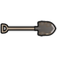 | **Gravedigger's spade** | 11 melee |  | A worn digging spade, its edge sharpened and caked with dry earth. It's cheap, and any downed afflicted it hits loses its head. Otherwise it's a poor club. |
| 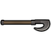 | **Hamstring hook** | 11 melee |  | A long pole with a hooked, inward-curving blade. It goes for the legs, so one of the afflicted can only crawl. That won't end one. It's a weak polearm otherwise. |
| 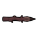 | **Hawthorn stake** | 10 melee |  | A knotted hawthorn stake, its point hardened in the fire. Hawthorn is slow to work and old stories trust it over any other wood: a thrust at a vampire finds the heart and holds it far more often than plain wood does. Against anything else it's a sharpened stick. |
| 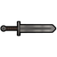 | **Headsman's sword** | 24 melee |  | A long, broad two-handed sword with a square, pointless tip, made for one job. It's slow and awkward, but it goes for the neck of the afflicted. Against anyone else it's clumsy, and it misses often. |
| 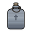 | **Holy water flask** | 14 holy water, range 12.9 |  | A flat pewter flask with a small cross stamped on it, used up when thrown. The water burns monsters in wounds that heal the slow way. It does nothing to people. |
| 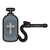 | **Holy water sprayer** | 4 holy water, range 7.9 |  | A garden pump with a steel backpack tank, a hose and a short wand, a cross painted on the tank. A short-range spray gives monsters a weak burn over a small area, puts out fires, and does nothing to people. |
| 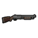 | **Incendiary shotgun** | 15 bullet, range 15.9 |  | A pump shotgun loaded with magnesium shells. Each blast hits a little softer than buckshot, but it often sets the target alight. Fire is the one wound a vampire can't easily shrug off. |
| 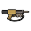 | **Pneumatic stake gun** | 17 stake bolt, range 12.9 |  | A workshop nail gun rebuilt to fire wooden bolts, with a short air tank under the barrel. Short range and much faster than a stake crossbow, and a bolt through a vampire's heart can pin it. Against anything else the bolts do little. |
| 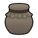 | **Quicklime pot** | 9 caustic splash, range 12.9 |  | A thick clay pot of quicklime sealed with waxed cloth, used up when thrown. A corpse in the splash can never be raised, and the patch eats at any afflicted that stands in it. On anyone else it's a mild burn. |
| 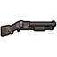 | **Rock salt shotgun** | 10 bullet, range 12.9 |  | A battered pump shotgun loaded with coarse rock salt. A blast stuns spirits and the afflicted. It barely hurts people. |
|  | **Salt sack** | 5 burst, range 9.9 |  | A small burlap sack slit at one corner, used up when thrown. The salt pours out in a ring a spirit won't cross for a day. It does nothing to anyone else. |
|  | **Silver nitrate flask** | 9 caustic splash, range 12.9 |  | A brown glass flask of silver salts in solution, used up when thrown. It burns a Garou on the spot and goes on burning for a few seconds. On anyone else it's a mild chemical burn. |
| 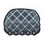 | **Silver wire net** | 5 burst, range 9.9 |  | A folded net of fine bright wire with lead weights along the edge, used up when thrown. A Garou caught in one is held down and can't change form until it rips the net apart with its own strength or someone cuts it free. Anyone else is only slowed, and soon tears loose. |
| 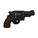 | **Silver-loaded revolver** | 12 bullet, range 25.9 |  | A short old revolver hand-loaded with silver. Each round burns a Garou like a silver blade. Silver is soft and light, so against anyone else it's a weak pistol that cost a fortune to load. |
| 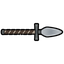 | **Silvered boar spear** | 17 melee |  | A broad silver-plated spearhead with a thick steel crossguard behind it. Made to stop a boar: a Garou that runs onto it loses its momentum and takes the burn. A plain, weak spear otherwise. |
|  | **Silvered man catcher** | 9 melee |  | A long pole ending in a two-pronged spring collar lined with silver spikes. It grips and slows whoever it catches, and burns a Garou for as long as it holds. It hardly hurts anyone else. |
| 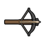 | **Stake crossbow** | 17 stake bolt, range 24.9 |  | A heavy crossbow that shoots sharpened hardwood bolts. It's slow to load. Hunters carry it for one reason: a bolt that finds a vampire's heart can pin it like a stake. |

## Apparel

| | Name | Value | What it is |
|---|---|---|---|
|  | **Changed shape** |  | Not a garment. It marks someone who has taken another shape, and goes when the shape does. |

## Items

| | Name | Value | What it is |
|---|---|---|---|
|  | **Grave dirt** |  | Damp, cold earth in small clumps, as if someone walked in from a fresh grave. |
|  | **Kennel** |  | Runs, posts and a tack wall where animals are trained. Assign up to six of your animals to it and name a kennel master: they learn half as fast again and forget their training at half the rate, and the kennel master trains them before any other handling work. |
|  | **Rope** | 5 | A short length of plaited rope, used up when it's tied. Right-click anyone downed, netted or asleep, a prisoner or one of your own, and a colonist fetches it and ties them hand and foot. They can't walk or crawl and can be carried like anyone downed, until they work loose or someone cuts them free. |

[← Core contents](README.md) · [The Rim by Night](../README.md)

---

This is not official World of Darkness material. Portions of the materials are the copyrights
and trademarks of Paradox Interactive AB, and are used with permission. All rights reserved. For
more information please visit worldofdarkness.com.
