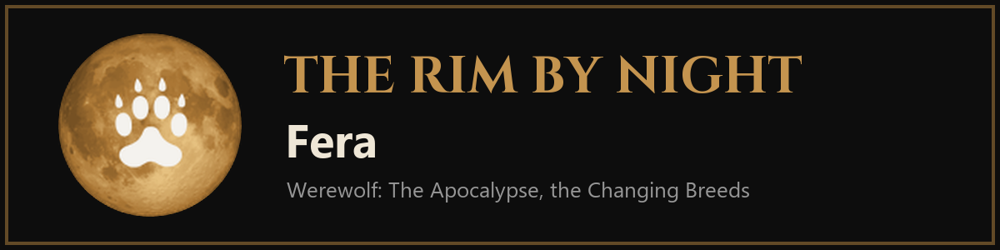

# Changing Breeds

> **Not released yet.** Fera is built but not on the Steam Workshop yet. These pages show what it will add; names and numbers may still change before release.

The Rim by Night: Fera is a DLC for Garou. It adds seven of the Changing Breeds from Werewolf: The Apocalypse,
20th Anniversary Edition, as kinds your colonists can be and as people out in the world. Each breed has its own
forms, Gifts, rites, Renown, weaknesses and ways of living.

Fera needs Harmony, The Rim by Night: Core and The Rim by Night: Garou, loaded in that order. It works with
Kindred, Imbued and Awakened too.

## The breeds

| Breed | What they are | Page |
|---|---|---|
| Corax | Wereravens: fragile, fast fliers who trade in secrets and drink the eyes of the dead | [Corax](Fera-Corax.md) |
| Ratkin | Wererats: mad, plague-proof saboteurs who live in tunnels and come in numbers | [Ratkin](Fera-Ratkin.md) |
| Ananasi | Werespiders: no Rage, a pool of blood that pays for everything, and a swarm form that survives death | [Ananasi](Fera-Ananasi.md) |
| Gurahl | Werebears: healers who pour Rage into their bodies, hibernate, and can bring a dead shifter back | [Gurahl](Fera-Gurahl.md) |
| Mokolé | Weresaurians: the memory of the dragons, fed by the sun, with a war form built from their own past | [Mokolé](Fera-Mokole.md) |
| Kitsune | Werefoxes: sorcerers and tricksters who don't regenerate and age slower with every rank | [Kitsune](Fera-Kitsune.md) |
| Nuwisha | Werecoyotes: Coyote's children, who teach through pranks and never frenzy | [Nuwisha](Fera-Nuwisha.md) |

## Pages

| Page | What's in it |
|---|---|
| [What every breed shares](Fera-Shared.md) | Rage, Gnosis and blood, forms, frenzy, the Delirium, bane metals, kin, the Joined Circle |
| [The world](Fera-World.md) | The breeds' hidden homes, first contact, the way in, wanderers, the War of Rage |
| [Crossover](Fera-Crossover.md) | How each breed gets on with Garou, Kindred, Imbued and Awakened, and the Embrace for each |
| [Scenarios and settings](Fera-Scenarios-and-Settings.md) | The nine scenarios, the making menu, the Fera tab, the main tab, alerts and settings |

[← Fera contents](README.md) · [The Rim by Night](../README.md)

## Reference

Every event, power, item and the rest, listed in full from the game files.

| Page |
|---|
| [Every event](Reference-Events.md) |
| [Every mission and quest](Reference-Missions.md) |
| [Every power](Reference-Powers.md) |
| [Every item](Reference-Items.md) |
| [Every building](Reference-Buildings.md) |
| [People, factions and creatures](Reference-People.md) |
| [Every condition](Reference-Conditions.md) |
| [Every thought and mood](Reference-Thoughts.md) |
| [Mental states and inspirations](Reference-Minds.md) |
| [Learning tips](Reference-Tips.md) |
| [Every setting](Reference-Settings.md) |
| [Every alert](Reference-Alerts.md) |
| [Everything else](Reference-Other.md) |

---

This is not official World of Darkness material. Portions of the materials are the copyrights
and trademarks of Paradox Interactive AB, and are used with permission. All rights reserved. For
more information please visit worldofdarkness.com.
