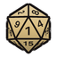

# Every power

Every power in this mod in one list: the ones learned, the ones items and forms give, and the ones only NPCs use. Cooldowns are in game time.

| | Power | Cost | Reach | Cooldown | What it does |
|---|---|---|---|---|---|
|  | **Airt Sense** |  | Self | 1 h | Knows the ways of the spirit world: every spirit on the map is named and the fog around it lifts. |
|  | **All Hell** | 2 Gnosis | Self | 1 day | Two Gnosis. A scream that breaks the mind: every mortal on the map whose Willpower is under the Twitcher's Infamy suffers the Delirium. |
|  | **Alter Lilian** |  | Self | 1 s | Reshapes the war form at will: more arms to carry with, longer legs to run on or thicker chitin to hide behind. |
|  | **Alter Mood** | 1 Gnosis | Touch | 1 h | A Gnosis and a touch lift someone's spirits for a day. |
|  | **Arachnophobia** | 1 Gnosis | 9.9 cells | 1 h | A Gnosis plants a fear of spiders: for a day a success, the victim runs from any werespider or insect it sees. |
|  | **Armor of the Tortoise** |  | Self | 1 h | Its hide hardens like a shell for half a minute: a tenth better armour a success. Once a fight. |
|  | **Aversion Therapy** | 1 Gnosis | Touch | 1 day | A Gnosis ties fear to a want. A colonist loses every addiction; a stranger loses its taste for raiding the colony, and its people warm to the bear's. |
|  | **Backbite** | 1 Rage, 1 Gnosis | 15 cells | 15 s | One Gnosis and one Rage. The Ratkin vanishes and is behind a foe up to 15 metres off, striking at once with a better chance to hit. |
|  | **Battery** | 1 Gnosis | Self | 12 h | One Gnosis. Brews a fizzing pick-me-up from junk: a dose for every two successes, each making a body stronger and quicker for four hours. It goes flat in a few days. |
|  | **Bellow** | 1 Rage | 12.9 cells | 1 h | A Rage point and a roar from the age of dragons: one mortal suffers the Delirium, its nerve the weaker for the Mokolé's Glory. |
|  | **Beneath Notice** | 1 Gnosis | Self | 1 h | A Gnosis makes the spider part of the background for four hours: unseen while it keeps still, and thieves overlook whatever lies within 6 metres of it. |
|  | **Beneath the Electron Bridge** | 1 Gnosis | 29.9 cells | 1 h | A Gnosis and the perfect thing to say to enrage someone. The target is furious for a day, and throws a tantrum unless its Willpower holds. |
|  | **Bestow Ursa's Blessing** | 1 Gnosis | Touch | 4 h | A Gnosis and a touch: The bear blesses body, heart or mind, for an hour a success. |
|  | **Blades of the Mantis** | 1 Rage | Self | 1 h | A blood point grows mantis blades from the forearms for an hour: aggravated cuts, though fine work comes hard. |
|  | **Blessing the Blade** | 1 Gnosis | Self | 4 h | A Gnosis and a spirit wakes in its weapon for an hour: each blow adds an aggravated wound. |
|  | **Blessings of the Nest** | 1 Gnosis | Touch | 1 day | A Gnosis and a blessing hissed in the Dragon Tongue: the one touched conceives with its partner, and sterility leaves it. An animal is bred at once; a person needs a partner on the map. |
|  | **Blind** | 1 Gnosis | 2.9 cells | 1 h | A Gnosis and a touch to the eyes: someone within three metres goes blind for a day, unless their Willpower holds. |
|  | **Blinding Spit** | 1 Rage | 4.9 cells | 1 h | A blood point of venom spat into the eyes of someone up to four metres away: blind for three seconds a success. |
|  | **Blisters** |  | Touch | 1 h | A touch, and ugly blisters cover the target's face for a day a success: beauty -2 and social impact -30%, unless its Willpower holds. |
|  | **Blood Omen** | 1 Gnosis | Touch | 1 day | A Gnosis and a sacrifice: a downed animal or a held prisoner is killed and its body read. The next big threat is named when it comes. |
|  | **Blood Pump** | 1 Gnosis | Self | 1 h | A Gnosis sets the heart racing for an hour: the spider moves and strikes as fast as a blood point would make it, the whole hour long. |
|  | **Bloody Feather Storm** | 2 Rage, 3 Gnosis | Self | 1 h | Three Gnosis and two Rage, in a flying form. A storm of razor feathers falls on everyone within 5 metres, friend or foe. |
|  | **Blur of the Weeping Eyes** |  | 6 cells | 10 s | Spits in a foe's eyes from six metres. They swell shut for three seconds a success. |
|  | **Bolt** | 1 Rage | 29.9 cells | 10 s | A Rage point and a bolt of fire at a foe up to thirty metres off: an aggravated burn, worse with every success. |
|  | **Bolt!** | 1 Rage, 1 Gnosis | Self | 1 h | One Gnosis and one Rage. Gone, and up to 15 metres off at the nearest way out in sight: a door, a rat-hole or the map's edge. |
|  | **Breaking the Tomorrow Wall** | 1 Gnosis | Self | 1 day | A Gnosis and a glimpse past tomorrow: for a day, the next great threat is foreseen. |
|  | **Breath of Ananasa** |  | Self | 1 h | Holds its breath for as long as it must: smoke, gas and bad air can't touch it for an hour. |
|  | **Breathe fire** |  | 5.9 cells | 1 day | Once a day, a gout of fire on a spot up to six metres off that burns everyone around it. |
|  | **Brethren Call** | 1 Rage | Self | 4 h | A blood point calls a swarm of spiders for an hour. They bite and poison every foe that comes within six metres. |
|  | **By the Light of the Moon** |  | Self | 1 h | Whatever the moon touches, it sees: every hidden foe within thirty metres shows. |
|  | **Cajole** | 1 Gnosis | 9.9 cells | 4 h | A Gnosis and a few kind words: for an hour, whoever it wheedles deals with the bear a fifth cheaper. |
|  | **Calcify** | 1 Gnosis | Self | 1 day | A Gnosis presses the Weaver's order on the buildings around: every one within thirty metres is mended by 30% of its strength a success. |
|  | **Call of the Dead** | 1 Rage | Touch | 1 h | A Rage point and a touch that calls the dead into the living: a wound that grows with every success. |
|  | **Call the Rain** | 1 Gnosis | Self | 1 day | A Gnosis, and the sky over the land opens: rain that puts out fires. |
|  | **Call to Allies** |  | Self | 15 days | Its last cry for help: Every friend on the map runs to it, and an ally with a settlement within 10 tiles sends fighters. Once a season. |
|  | **Carapace** | 1 Gnosis | Self | 1 h | A Gnosis hardens the skin into chitin for an hour: armour like a flak vest, and wounds close as a Garou's do. |
|  | **Carrion Clothes** | 1 Gnosis | Self | 4 h | A Gnosis, and it seems dead to anyone who looks: enemies and hungry animals pass it by for an hour, until it acts. |
|  | **Carrion's Call** |  | Self | 1 h | A vulture's nose for the dead: every corpse on the map is found and the fog over it lifts. |
|  | **Cartoon Physics** | 1 Gnosis | 14.9 cells | 1 h | A Gnosis and it runs on thin air, over water, chasms and walls, to a spot up to fifteen metres off. As long as it doesn't look down. |
|  | **Cheese It!** | 3 Rage, 3 Gnosis | Self | 12 h | Three Gnosis and three Rage. The whole pack on the map Bolts at once, each to its own way out. |
|  | **Clear Mind** | 1 Willpower | Self | 1 day | A Willpower turned to thought: it studies and talks a tenth better until sunrise. |
|  | **Climate Control** | 1 Gnosis | Self | 1 h | A Gnosis softens the air for an hour: everyone on its side within twelve metres bears heat and cold three degrees better a success. |
|  | **Cloak of Shadows** | 1 Gnosis | Self | 4 h | One Gnosis. The Ratkin, and anyone touching it, fade into the shadows for four hours. Attacking gives them away. |
|  | **Compel Truth** | 1 Gnosis | 4.9 cells | 4 h | A Gnosis and the target can't lie to the bear: it gives up a secret it keeps. |
|  | **Corrupt** | 1 Gnosis | 9.9 cells | 1 h | A Gnosis rots what was made: a building, or a foe's weapon and clothes, falls apart a little with every success. |
|  | **Crawling Chaos** |  | 3.9 cells | 10 s | Scuttles up and over a wall or fence like a lizard, landing up to three metres away. Free, and ready again in ten seconds. |
|  | **Crush** | 1 Rage | 4.9 cells | 1 h | Its grip reaches across the room: a crushing squeeze on someone up to four metres away, harder with every success. |
|  | **Curse of the Great Web** |  | Touch | 1 h | A touch binds someone to the world of flesh: for an hour it can't step sideways. |
|  | **Curse of Tiresias** | 1 Gnosis | Touch | 1 day | A Gnosis and a harmless blow: the target becomes the other sex, as a sibling of itself, for three days. |
|  | **Darksight** | 1 Willpower | Self | 1 h | A Willpower, and for an hour darkness is no hindrance to it. |
|  | **Darksight** | 1 Willpower | Self | 1 h | A Willpower and the dark doesn't slow it for an hour. |
|  | **Darksight** |  | Self | 8 h | Sees in pitch dark as in daylight for eight hours. |
|  | **Dead Talk** | 1 Gnosis | Touch | 1 h | One Gnosis. A corpse up to a day dead answers: its killer, then a secret, and with three successes what it had hidden on it. |
|  | **Death Ray** | 1 Gnosis | 15 cells | 1 h | One Gnosis. A beam of junk-built light at a foe within 15 metres that burns through flesh and armour, harder with each success. |
|  | **Deceptive Demise** | 1 Gnosis | Self | 4 h | One Gnosis and a real wound. The Corax dies in a puff of feathers, blood and ash, and is in the spirit world at once. |
|  | **Deep Pockets** |  | Self | 1 day | Stows things where no one finds them: for a day the Ratkin carries 40 kilograms more. |
|  | **Delay the Death Bear's Coming** | 1 Gnosis | Touch | 1 h | A Gnosis and a touch: For an hour the wounded can't die of their wounds, though they stay down. |
|  | **Devour the Dead** | 1 Gnosis | 6 cells | 1 h | One Gnosis. Rat-spirits eat a corpse within six metres, gear and all, in a few seconds. No one will learn anything from that body. |
|  | **Disappearing Act** | 1 Gnosis, 1 Willpower | Self | 4 h | A Willpower and a Gnosis. While it stands still, nothing can see or target it. The first step ends it. |
|  | **Distant Whispers** | 1 Willpower | Self | 4 h | A Willpower and its voice comes out of the river, the fire or the storm: everyone of its side, on every map, shares Mindspeak. |
|  | **Dragon Ally** | 2 Gnosis | Self | 1 day | Two Gnosis and a dragon of earth, water or fire comes to fight for it for an hour. |
|  | **Dragon Drill** | 1 Gnosis | Self | 1 day | A Gnosis and the Mokole drills its workforce: for an hour, it and an ally a success within fifteen metres each use the best level any of them has in every skill. |
|  | **Dragon's Breath** | 1 Rage | 8.9 cells | 10 s | A Rage point and a gout of fire at a foe up to nine metres off: a deep, aggravated burn. |
|  | **Draw the Portable Door** |  | Touch | 1 h | A Gnosis roll at 7: A chalk door on the wall beside the carrier takes it through to the far side. One time in five it opens somewhere else within thirty cells. |
|  | **Dreams of the Buri-Jaan** | 1 Gnosis | Self | 60 days | A Gnosis and the Gurahl dreams of a lost cub, and the cub dreams back: a young Gurahl fresh from its First Change finds the way and joins, with the dreamer as its Buri-Jaan. Once a year. |
|  | **Earworm** | 1 Gnosis | 14.9 cells | 1 h | A Gnosis, and a tune plays in the target's head for a day a success. Research, crafting and tending go 20% slower, unless its Willpower holds. |
|  | **Elemental Meld** | 1 Gnosis | 24.9 cells | 1 h | A Gnosis and it steps into the rock or water beside it, to come out by a cell that the same rock or water touches. |
|  | **Emperor's Clothes** |  | 9.9 cells | 1 h | A flick of the wrist and one of the target's garments lands at the Nuwisha's feet. The target is left embarrassed. |
|  | **Enduring Warrior** | 1 Rage | Self | 4 h | A Rage point, and for an hour its wounds close as a Garou's do. |
|  | **Enemy Ways** |  | Self | 10 s | A stormcrow's warning: Every foe within 30 metres is named over their head and the fog around them lifts. |
|  | **Entropic Bite** | 2 Gnosis | Touch | 1 h | Two Gnosis put rot in a bite. The flesh around it dies and keeps dying: an aggravated wound every three seconds, three seconds a success. |
|  | **Eye of the Raptor** |  | Self | 1 h | Eyes like a raptor of old: the land around it shows itself, fifteen metres a success. |
|  | **Eye pluck** |  | Touch | 5 s | A peck straight at the eye. It lands half as often as a plain blow, but a hit tears the eye out with a wound that won't heal by itself, even from a raven. |
|  | **Eyes of the Eagle** |  | Self | 4 h | An eagle's eyes for four hours: sharper sight and a surer aim, through dark, smoke and fog. |
|  | **Fable** | 1 Willpower | 24.9 cells | 4 h | A Willpower and a tale: One listener thinks well of the Kitsune, or keeps calm, for as many days as its Wisdom. |
|  | **False Spoor** | 1 Gnosis | 24.9 cells | 4 h | A Gnosis and it smells exactly as the target, for its Humor in days. Scent of the True Form reads the target instead. |
|  | **Fan-Shadow-Robe** | 1 Gnosis | Self | 4 h | A Gnosis and another face for an hour: another skin, another head of hair. |
|  | **Feast of the Dead** |  | Touch | 1 day | Eats the heart of a dead supernatural to take three of its powers for a day. Once a body. |
|  | **Filch** |  | Touch | 1 h | Lifts something from a person's pack in plain sight. Takes three successes; the victim never knows. |
|  | **Finders Keepers** | 1 Gnosis | Touch | 1 day | A Gnosis and a touch put Coyote's mark on someone for a season: spirits keep away from it, banes and allies alike. |
|  | **Firebug** | 1 Rage | 3.9 cells | 10 s | One Rage. Sets fire to something that burns within three metres, as long as no one is wearing or carrying it. |
|  | **Flight of Separation** | 2 Gnosis | Self | 4 h | Two Gnosis. The Corax bursts into a murder of ravens and only one of them is real: it takes the raven's form and goes unseen until it strikes. |
|  | **Flow of Aura** | 1 Gnosis | Self | 4 h | A Gnosis and it reads what a place remembers: every tale of this place from the last day a success. |
|  | **Fly** |  | 25 cells | 2 s | Takes to the air and lands at a spot in range, over walls, water and anyone in the way. A Corax born human flies shorter hops than one born a raven. |
|  | **Fool's Luck** | 1 Gnosis | Self | 1 day | A Gnosis and bad luck can't touch it for half a day: no botches, only plain failures. |
|  | **Fool's Luck** | 1 Gnosis | 24.9 cells | 10 s | A Gnosis and the target's luck runs out: for ten seconds its Gifts fail, its shifts stall and its wounds won't close. |
|  | **Forbidden Words** | 1 Gnosis | 4.9 cells | 4 h | A Gnosis and the target can't speak of what it saw: whatever it witnessed of the colony, it will never tell. |
|  | **Forgetfulness** | 1 Gnosis, 1 Willpower | 2.9 cells | 1 h | A Gnosis and a Willpower, and someone close forgets: a bad memory a success is gone, the worst first, unless their Willpower holds. |
|  | **Friend and Foe** | 1 Gnosis, 1 Willpower | 24.9 cells | 1 day | A Willpower and a Gnosis: the target's people trust the Nuwisha as one of their own for a day a success, until it strikes. |
|  | **Gaia's Breath** |  | Touch | 1 day | The werebears' great secret. On the body of a dead shapeshifter, it gives up a permanent Gnosis and a permanent Willpower and breathes life back: Charisma and Medicine at 6, one harder for every hour since the death. It can be tried once on anyone. A botch lets a Bane in instead. |
|  | **Gauntlet Runner** | 1 Gnosis | Self | 4 h | One Gnosis. The Gauntlet thins within 18 metres for four hours, and anyone there steps sideways as if they held a mirror. |
|  | **Ghost Danse** | 2 Willpower | Self | 4 h | Two Willpower and it dances in both worlds at once for an hour: most blows pass through it. |
|  | **Ghost Speech** |  | Touch | 1 h | It speaks into the Yin Realm: the dead in a grave or a body say how they died. |
|  | **Gift of Rage** | 1 Willpower | Self | 4 h | A Willpower, and for an hour it has five Rage to spend as a Garou does. It can frenzy, and silver burns it. |
|  | **Hand Fangs** | 1 Rage | Self | 1 h | A blood point grows venom fangs in the palms for an hour. Every blow with the hands bites and poisons, in any form that has hands. |
|  | **Happy Thoughts** | 1 Gnosis | Touch | 1 h | A Gnosis and a touch: For an hour the target can't frenzy or spend Rage. |
|  | **Hot Ichor** | 1 Rage | Self | 18 s | A Rage point boils its blood: it hits harder and moves faster for eighteen seconds. |
|  | **Hummingbird Dart** | 1 Rage | Self | 4 h | One Rage, in a flying form. For four hours the Corax can throw its feathers like darts up to 15 metres. |
|  | **Hydraulic Strength** | 1 Rage | Self | 1 s | Pumps blood into the muscles: Strength +1 for each blood point spent, up to its rank, for an hour. |
|  | **Hyperattenuation** | 1 Willpower | Self | 4 h | One Willpower. Senses stretched past belief: everything within 60 metres comes clear, hidden foes too. |
|  | **Ill Winds** | 3 Rage | Self | 1 day | Three blood points thin the Gauntlet over the whole map: a point lower a success, for an hour a success. |
|  | **Image of the Great Mother** | 2 Gnosis | Self | 1 day | Two Gnosis and Charisma at 9: for an hour the Ananasi takes the Queen's own shape, Strength +5 and Stamina +6 with great claws, and everyone who sees it suffers the Delirium. A week stuck in the swarm follows. |
|  | **Image of the Sky Bear** | 1 Gnosis | Self | 4 h | A Gnosis calls down the seven stars of the Great Bear: every friend within six metres has a wound a success closed, aggravated ones too. |
|  | **Imperial Authority** |  | Self | 4 h | A stare that makes it everyone's better for an hour: people listen to it and animals let it tame them. |
|  | **Improvisation** | 1 Rage | Self | 4 h | One Rage. Anything in hand is a deadly weapon for four hours: a stone, a bottle, a chair leg. |
|  | **Inflict Pain** | 1 Rage | Self | 4 h | One Rage. For four hours each blow racks the victim with pain, worse with each success up to three. |
|  | **Instinct** | 1 Rage | 24.9 cells | 15 s | One Rage, against the target's Willpower. For three seconds the target loses all restraint and lashes out at whoever is nearest. |
|  | **Jointsnake's Mojo** | 1 Gnosis | Touch | 4 h | A Gnosis and a touch: A limb lost within the hour crawls back and joins again. |
|  | **Ju-Fu: Attraction** | 1 Gnosis | Self | 1 day | Paper magic. A Gnosis and a herd of the land's wild animals wanders in. |
|  | **Ju-Fu: Beast Shape** | 1 Gnosis | Self | 1 h | Paper magic. A Gnosis and it takes the shape of the animal folded in the paper, as Thousand Forms. |
|  | **Ju-Fu: Lantern** | 1 Gnosis | 24.9 cells | 10 s | Paper magic. A Gnosis folds a paper lantern that lights the spot for an hour. |
|  | **Ju-Fu: Paper Beast** | 2 Gnosis | Self | 4 h | Paper magic. Two Gnosis and a paper wolf grows to full size and obeys it for an hour. One wound tears it. |
|  | **Ju-Fu: Paper Flesh** | 3 Gnosis | Self | 4 h | Paper magic. Three Gnosis and a paper wolf becomes flesh and blood, to fight for it for an hour. |
|  | **Ju-Fu: Silver Sigil** | 1 Gnosis | Self | 1 h | Paper magic. A Gnosis and a paper "badge" that guards take for the real thing: for an hour it sneaks into any settlement. |
|  | **Ju-Fu: Umekochi's Mouth** | 1 Gnosis | 24.9 cells | 10 s | Paper magic. A Gnosis folds a paper box that holds four stacks in one cell, for a day. |
|  | **Kuei Dance** | 1 Willpower | Touch | 4 h | A Willpower and the dead in a grave or a body act out their story: how they died, at two successes who they last fought, at three a last wish for the one they loved most. |
|  | **Lay a thread** |  | Touch | 1 s | Lay a thread of the Tracking Web on someone or something within reach. |
|  | **Lesions** | 1 Gnosis | Self | 4 h | One Gnosis. For four hours each bite or claw raises weeping sores that keep the victim from running. |
|  | **Living Treasure** | 1 Gnosis | Touch | 4 h | A Gnosis and the Mokole's own spirit wakes a fetish or a talen: a use back a success, and a sulking spirit listens again. |
|  | **Long Running** | 1 Gnosis | Self | 1 day | A Gnosis and the road shortens: a caravan it travels with goes faster for a day. |
|  | **Mangi's Strong Arms** | 1 Rage | Self | 10 s | A Rage point into the arms: its blows land half again as hard for ten seconds. |
|  | **Many Eyes** | 1 Rage | Self | 1 h | A blood point opens eyes all over the body for an hour: nothing takes the Ananasi from behind or by surprise. |
|  | **Marionette** | 1 Willpower | 24.9 cells | 4 h | A Willpower and the target moves as the Kitsune mimes: under its control for six seconds a success, and no powers. |
|  | **Masking the Hunted** | 1 Gnosis | Self | 4 h | A Gnosis hides everyone friendly within eight metres from their enemies, an hour a success, until they attack. |
|  | **Mimic a predator's cry** |  | Self | 1 h | The cry of something bigger and hungrier. Wild animals within ten metres run. |
|  | **Mimic laughter** |  | Self | 1 h | Laughter from nowhere. Everyone within eight metres is unsettled for half a day. |
|  | **Mind of the Swarm** | 1 Gnosis | Self | 12 h | One Gnosis. Rats pour out of the ground and fight for the Ratkin for four hours: four, and three more for each success. |
|  | **Mind Sight** | 1 Gnosis | 24.9 cells | 1 h | A Gnosis reads what's on someone's mind: what it's doing now and the thoughts that weigh on it most. |
|  | **Minor Unweaving** | 1 Gnosis | 9.9 cells | 1 h | A Gnosis unpicks a lesser working: ends the strongest rank 1 or 2 Gift lasting on someone, a friend's curse or a foe's blessing. |
|  | **Moon Dance** | 1 Gnosis | Self | 1 day | A Gnosis, and for the night it moves unseen. Attacking gives it away. |
|  | **Morse** |  | Self | 1 day | Taps out a call for help that only the right ears hear. With three successes an allied faction sends fighters, as a call for military aid would. |
|  | **Mousetrap** | 1 Gnosis | 4.9 cells | 1 h | One Gnosis. Rigs a deadly trap on a spot within five metres out of ten pieces of junk lying near it: scrap, chunks, old clothes. |
|  | **Mynah's Touch** | 2 Gnosis | Self | 4 h | Two Gnosis. Borrows any Garou Gift of a lower rank for four hours, one at a time. |
|  | **Natural State** | 1 Gnosis | Self | 1 day | A Gnosis and the land around goes back to the wild, six metres for each point of Honor: floors come up, buildings half fall in, grass grows over all. |
|  | **Nature's Plenty** | 1 Gnosis | Self | 1 day | A Gnosis, and the land gives what someone in need must have: a simple meal and a herbal medicine, in any season and any biome. |
|  | **New Face** | 1 Gnosis | Self | 1 day | A Gnosis and a new face for three days: another skin, another head of hair. |
|  | **Night eyes** | 1 Gnosis | Self | 4 h | One Gnosis. A rat's eyes for four hours: the dark slows the Ratkin no more than daylight. |
|  | **Now You Don't** | 1 Gnosis | 24.9 cells | 4 h | A Gnosis and weapons vanish from the target's sight for the Nuwisha's Humor in hours: it drops what it holds and can't find another. |
|  | **Pain Remains** | 1 Gnosis | 24.9 cells | 1 h | A Gnosis and the target's pain won't fade, however it heals, for four hours. |
|  | **Paint the Meadows** |  | 15 cells | 1 h | Pitiful moans draw a creature up to fifteen metres off toward the Mokole, three seconds a success, until something hurts it. |
|  | **Past Whispers** |  | Self | 1 h | It hears what was said in this room in the last day, two things a success. |
|  | **Patience of Ananasa** |  | Self | 4 h | Waits in perfect stillness: unseen until it strikes, for four hours, and its blows land harder. |
|  | **Playing the Heart-Strings** | 1 Gnosis, 1 Willpower | Touch | 15 days | A Gnosis, a Willpower and a touch: within twelve months, fewer a success, a chain of odd chances brings the target true love. The Nuwisha must have no lover of its own. |
|  | **Poison Food** | 1 Gnosis | Self | 1 h | One Gnosis. All food near the Ratkin, more of it the greater its Infamy, turns bad: whoever eats it gets food poisoning. |
|  | **Poisoned bite** |  | Touch | 1 day | Once a day, a bite full of venom. |
|  | **Portents** | 2 Gnosis | Self | 1 day | Two Gnosis, under the night sky. A wind-spirit shows what's to come: one question, answered truly but in symbols, and plainly with three successes. |
|  | **Possession** | 1 Gnosis, 1 Willpower | Touch | 1 day | A Gnosis, a Willpower and a touch: the Kitsune leaves its body to ride the target's, a day a success. Its own body lies in a trance meanwhile. |
|  | **Predator's roar** |  | Self | 1 h | A roar from the age of the dinosaur kings. Everyone within three metres, friend or foe, runs for six seconds unless their Willpower holds against its Rage. |
|  | **Probe Thoughts** | 1 Gnosis | 24.9 cells | 4 h | A Gnosis digs into a mind: one success shows what it truly is, two a secret it keeps. |
|  | **Pyrotechnics** | 1 Rage | Self | 4 h | One Rage. Builds bombs from ten pieces of junk lying near: a grenade for every two successes, at least one. |
|  | **Quell Mob Rage** | 1 Gnosis | Self | 4 h | A Gnosis and a word calm everyone within fifteen metres: fights and furies end, and Rage cools. |
|  | **Rage of the Mother Bear** | 1 Gnosis | Self | 1 h | A Gnosis, and it moves and strikes twice as fast for two seconds a success. |
|  | **Rage of the Nest Mother** |  | Self | 1 h | When a kin or a child in its sight has just been hurt, the Mokole draws on a mother's fury: Strength +2 for an hour and a point of Rage. |
|  | **Rat's Judgment** | 1 Rage | Self | 4 h | One Rage. For four hours the Ratkin's blows land harder on the Wyrm's own, tainted humans among them. |
|  | **Rat's Teeth** | 1 Rage | Self | 4 h | One Rage. The thrown weapon in hand doesn't run out: copies of it fill the Ratkin's pack for four hours, then crumble. |
|  | **Raven's Gleaning** |  | Self | 1 h | A glance tells what's worth having: the three most valuable loose things within 40 metres are priced over them, and anyone close by with a fortune on them gives up a secret. |
|  | **Razor Feathers** | 1 Gnosis | Self | 4 h | One Gnosis, in Crinos. The feathers turn to steel for four hours, and the Corax can slash with its wings. |
|  | **Recapitulate** | 2 Gnosis | 24.9 cells | 4 h | Two Gnosis and a foe slides back down the tree of life, ten minutes a success: a rat, then a lizard, then a beetle at three successes. Its gear falls away and it can use no powers. |
|  | **Refresh** | 1 Gnosis | Touch | 1 h | A Gnosis and a touch: No pain and no wound penalties for an hour. |
|  | **Replenishment of the Flesh** | 1 Gnosis | Self | 1 h | A Gnosis knits the flesh: one wound closes a success. Aggravated wounds stay. |
|  | **Safe Passage** | 1 Gnosis | Self | 1 h | A Gnosis and the bear's friends within three metres leave no trace for an hour: unseen while no foe has a clear line to them. |
|  | **Scamper** | 1 Gnosis | Self | 4 h | One Gnosis, to run. For four hours the Ratkin is much harder to hit, but attacking ends it and empties its Rage and Gnosis. |
|  | **Scorpion Tail** | 3 Rage | Self | 1 h | Three blood points grow a stinging tail for an hour: aggravated stabs that carry its venom. |
|  | **Seal of Inari** |  | 24.9 cells | 4 h | A ghostly mark only Kitsune see: a death mark turns them against its bearer, a call for help wins their friendship, a warning makes them wary. |
|  | **Seduction** | 1 Gnosis | 24.9 cells | 4 h | A Gnosis and a person falls for the Kitsune: opinion +10 a success, up to +30, for a season. |
|  | **Seek** | 1 Gnosis | Self | 4 h | A Gnosis and the local spirits say where one person is, if within 30 tiles. |
|  | **Sense Gold** |  | Self | 10 s | Senses every piece of gold on the map, and every gold weapon in a hand. |
|  | **Sense Hostility** |  | Self | 1 h | It feels hostile minds within thirty metres, hidden or not. |
|  | **Sense Imbalance** |  | Self | 1 h | It feels which of the Triat holds the land: the Wyrm's taint, the Weaver's building or the Wyld's growth. |
|  | **Sense Motion** |  | Self | 10 s | Feels everything that moves within fifteen metres, through walls and in the dark. |
|  | **Sense Need** | 1 Gnosis | Self | 4 h | A Gnosis and the bear feels who needs it: everyone friendly, on any map, who is down, bleeding, starving or sick. |
|  | **Sense Weaver** |  | Self | 10 s | Feels the Weaver's hand: every machine on the map, mechanoid and turret, is marked and the fog over it lifts. |
|  | **Shadow-Fan-Flowers** | 1 Gnosis | 19.9 cells | 1 h | A Gnosis and a perfect illusion: the target sees a threat that is not there and runs, six seconds a success, unless its Willpower holds. |
|  | **Shattering** | 3 Gnosis | 9.9 cells | 1 h | Three Gnosis tear any working apart: ends the strongest Gift lasting on someone, whatever its rank. |
|  | **Sheep's Clothing** | 1 Gnosis | 24.9 cells | 4 h | A Gnosis and it looks, smells and moves like the shifter aimed at, for a day a success: that one's people take it for one of their own until it strikes. |
|  | **Shelter of the Earth** | 1 Gnosis | Self | 1 h | A Gnosis, and the land hides it: unseen for an hour, until it attacks. |
|  | **Sigil** | 1 Gnosis | Self | 15 days | One Gnosis. A rat sign scratched anywhere, read by other Ratkin who pass: once a quadrum it tells of a site within 30 tiles. |
|  | **Silence** | 2 Gnosis | 24.9 cells | 4 h | Two Gnosis and an eerie quiet falls, four metres a success, for an hour: no one inside can speak. |
|  | **Silent Running** | 1 Gnosis | Self | 4 h | One Gnosis. Leaves no trace for four hours: a little quicker, and unseen by any foe who has no clear line to it. |
|  | **Sky's Beneficence** |  | 15 cells | 10 s | Drops what the Corax carries exactly on a spot within 15 metres: a grenade goes off there, and anything else lands at someone's feet. Only in a flying form. |
|  | **Sleep of the Ages** |  | Touch | 1 h | A touch on a sleeper, and nothing wakes it for an hour a success: no noise, no raid, no alarm. |
|  | **Slicing Teeth** | 1 Rage | Self | 4 h | One Rage. Teeth and claws honed for four hours: they cut deeper and through armour. Not in Homid. |
|  | **Slip the Bad Medicine** |  | Touch | 1 day | A Gnosis roll at 6: Someone within reach sickens for a month with an illness no doctor finds. Work goes 15% slower. |
|  | **Sliver Tooth** | 1 Rage | Self | 4 h | One Rage. For four hours every bite leaves splinters of tooth in the wound, which won't heal until a doctor digs them out. Not in Homid. |
|  | **Sniffle** | 1 Gnosis | Self | 15 s | One Gnosis. Anyone hiding near the Ratkin sneezes and gives themselves away. |
|  | **Song of Fear** | 1 Rage | 14.9 cells | 1 h | A Rage point and its own fox's fear cast into a foe: it runs for six seconds a success, unless its Willpower holds. |
|  | **Song of Terra** | 1 Gnosis | Self | 4 h | A Gnosis and the earth sings what happened here: every tale of this place from the last day a success. |
|  | **Sorcerous Bite** | 1 Gnosis | Self | 4 h | A Gnosis and its teeth turn to jade for an hour: each blow adds a deep aggravated wound. |
|  | **Spin a cobweb** |  | Touch | 2 s | An ordinary cobweb, best across a doorway. Anyone not of the colony who walks through it, the colony hears of. |
|  | **Spin a web floor** |  | 3.9 cells | 2 s | Sticky web over one cell of ground. Anyone crossing it wades. |
|  | **Spin a web wall** | 1 Rage | 3.9 cells | 5 s | A blood point spins a wall of web on one cell, across a doorway or a gap. It's as strong as a steel wall but burns like wood. |
|  | **Spirit Healing** | 1 Gnosis | Touch | 1 h | A Gnosis heals a spirit: one wound a success. |
|  | **Spirit Shape** | 1 Gnosis | Self | 1 day | A Gnosis and the bear looks like a spirit to spirits, a day a success: banes and the rest leave it be. |
|  | **Spirits of Laughter** | 1 Gnosis | Self | 4 h | A Gnosis and laughter spirits fill the air for an hour: everyone within thirty metres keeps their temper, and fewer break or frenzy. |
|  | **Squeeze** | 1 Willpower | 2.9 cells | 5 s | One Willpower. Slips through a crack in a wall or a closed door, coming out up to two metres away on the other side. |
|  | **Sticky Paws** | 1 Rage | 4.9 cells | 15 s | One Rage. Snatches the weapon out of a foe's hands within five metres and holds it. |
|  | **Stolen Moments** | 1 Gnosis | Touch | 1 h | A touch and a Gnosis take the last quarter hour from someone's memory, and whatever they saw in it. |
|  | **Stonesight** |  | Self | 1 h | Knows the stone around it: the map clears five metres a success, through rock and walls. |
|  | **Stop Continental Drift** | 2 Gnosis | Self | 1 day | Two Gnosis and the world remembers it was once one land: a caravan it travels with goes three times as fast for a day. |
|  | **Stop Hitting Yourself** | 1 Gnosis, 1 Willpower | Self | 1 h | A Willpower and a Gnosis. The next blow to land on it within the hour goes back to its attacker instead, past armour. |
|  | **Sun Enfleshed** | 3 Gnosis | Self | 4 h | Three Gnosis and it burns in silent sun-fire for an hour: its blows burn. |
|  | **Sun's Guard** | 2 Rage | Self | 10 s | Two Rage. Raven's sunlight wraps the Corax: no fire or heat touches it for three seconds a success. Balefire still burns. |
|  | **Survival** | 1 Gnosis | Self | 1 day | One Gnosis. A day without needing food. |
|  | **Suspicious Glance** |  | 19.9 cells | 1 h | A sly look, and the target starts to distrust the friend it likes best. Its opinion of them drops by 30 for three days, unless its Willpower holds. |
|  | **Swallow's Return** | 1 Gnosis | Self | 1 day | One Gnosis. For two days a caravan with this Corax in it heads home three times as fast. |
|  | **Swarm of Servants** | 1 Willpower | Self | 4 h | A Willpower and from the fur of its tail come rats, two a success, to fight for it for an hour. |
|  | **Swollen Tongue** |  | Touch | 1 h | A touch, and the target's tongue swells until it can't say a word for an hour, unless its Willpower holds. |
|  | **Tame Sunbeam** | 1 Gnosis | Self | 4 h | A Gnosis and the sun sends its light: real sunlight for an hour, two metres a success around where the Mokole stands. Vampires in it burn as by day. |
|  | **Taste of Madness** | 1 Gnosis | 24.9 cells | 1 h | One Gnosis, against the target's Willpower. A lie so good the target believes it: they wander in a daze for an hour a success and won't fight. |
|  | **Ten Chi** | 1 Gnosis | Self | 1 h | A Gnosis and it knows where it stands and which way home lies. |
|  | **Theft of Stars** | 1 Rage, 1 Willpower | 24.9 cells | 4 h | One Willpower and one Rage. Helios takes the target's natural light: they can hardly see for two hours and an hour a success. |
|  | **Threaten** | 1 Rage | Self | 1 h | A Rage point and a roar: enemies within eight metres flee for three seconds a success, unless their Willpower holds. |
|  | **Throw a razor snare** | 1 Rage | 5.9 cells | 5 s | A blood point of cutting web thrown over someone up to six metres away. It can't move or fight until it breaks free on Strength at 9, and takes an aggravated wound every three seconds until it does. |
|  | **Throw a snare** | 1 Rage | 5.9 cells | 5 s | A blood point of web thrown over someone up to six metres away. It can't move or fight until it breaks free on Strength at 9. |
|  | **Throw feathers** |  | 15 cells | 2 s | Feathers thrown like darts. |
|  | **Thunderbolt** | 1 Rage | 29.9 cells | 20 s | One Rage. Calls lightning from the clouds onto a foe it can see. |
|  | **Tiny Coyote** | 1 Gnosis | Self | 1 h | A Gnosis, and for an hour it shrinks to the size of a mouse and slips under any door, locked or not. |
|  | **Treeshake** | 1 Gnosis | Touch | 1 day | A Gnosis and a shake of any tree bring down berries and nuts: ten meals' worth a success, in any season. |
|  | **Trickster's Skin** | 1 Gnosis | 24.9 cells | 4 h | A Gnosis and it wears the target's looks, voice and scent for an hour: that one's people take it for theirs until it strikes. |
|  | **Two Tongues** | 1 Willpower | Self | 1 h | A Willpower and for an hour it holds two conversations at once, each listener hearing only its own: its words carry twice the weight. |
|  | **Ultimatum** | 1 Gnosis | 12.9 cells | 1 h | A Gnosis and a stare that leaves the foe one choice: run. It flees for three seconds a success unless its Willpower holds. |
|  | **Umbral Gateway** | 3 Gnosis | Self | 4 h | Three Gnosis open a door through the Gauntlet: the Danser and its friends within three metres walk through, with no roll. |
|  | **Urban Camouflage** |  | Self | 4 h | Just another face in the crowd: for four hours no one picks the Ratkin out until it attacks. |
|  | **Ursa's Light** | 1 Gnosis | Self | 1 h | A Gnosis calls down starlight: a soft light twelve metres around, for an hour. |
|  | **Uzume Sings** | 1 Gnosis | 14.9 cells | 1 h | A Gnosis and a song that holds a foe still, six seconds a success, unless its Willpower holds. |
|  | **Voice Bank** | 1 Gnosis | 24.9 cells | 1 h | A Gnosis and it shouts "fall back" in the voice of the one it aims at. That one's side within 20 metres falls back, six seconds a success. |
|  | **Voice of the Mimic** |  | 24.9 cells | 15 s | A friend's voice from a spot of the Corax's choosing. Foes within 15 metres of the Corax go to see what their ally wants, for five seconds. |
|  | **Voice of Woe** | 1 Gnosis | Self | 4 h | A Gnosis and a cry of grief: every Gaian shifter of the colony within a tile a success hears it. |
|  | **Wake the Plenipotentiary** |  | Self | 6 h | A Gnosis roll at 5: For half a minute no foe picks the wearer out, as long as it doesn't attack. |
|  | **Waken** | 1 Gnosis | Touch | 1 h | A Gnosis and a touch wake someone from an unnatural sleep: a hibernation, a drugged stupor. |
|  | **Walk Like a Man** |  | Self | 1 h | Leaves the prints it chooses for an hour: it hunts unheard, and nothing about its war form strikes the Delirium. |
|  | **Ways of the Tapestry** | 1 Gnosis | Self | 1 day | A Gnosis and the bear sees how things connect: it learns a secret of one of the world's factions. |
|  | **Weather Watch** |  | Self | 1 day | Reads the sky: The highs and lows of the next three days, and how long what's on the map will last. |
|  | **Web Sheet** | 2 Rage | 24.9 cells | 4 h | Two blood points throw a sheet of sticky web over a wide field: every foe within fifteen metres of the spot is caught until it tears free on Strength at 9. |
|  | **Whisper Catching** |  | 20 cells | 1 h | Hears what someone within 20 metres would rather keep quiet, and learns a secret about them, unless their will is the stronger. |
|  | **Wire Sitter** |  | Self | 1 day | Listens in on the lines a comms console on the map carries, and learns a secret about a faction. |
|  | **Word Beyond** | 1 Gnosis | Self | 15 days | One Gnosis. A raven mark in the spirit world, where other Corax leave word: once a quadrum it tells of a site within 30 tiles. |

[← Fera contents](README.md) · [The Rim by Night](../README.md)

---

This is not official World of Darkness material. Portions of the materials are the copyrights
and trademarks of Paradox Interactive AB, and are used with permission. All rights reserved. For
more information please visit worldofdarkness.com.
