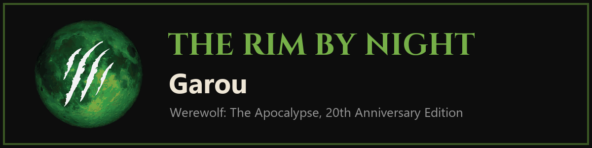

# The Rim by Night: Garou

The Rim by Night: Garou brings Werewolf: The Apocalypse, 20th Anniversary Edition, to RimWorld.
Your colonists can be Garou: werewolves of the thirteen tribes, with five forms, Rage and Gnosis,
Gifts taught by spirits, rites, packs and totems. Around them are kinfolk, caerns, the spirit
world next door, and the Wyrm and its servants.

This wiki covers everything in the mod: how being Garou works, the tribes, breeds and auspices,
every Gift, rite, totem and fetish, each tab and menu, the events, and the settings.

> **In development.** Balance will change and bugs are likely. Keep a backup of any save you add
> the mod to.

## New here?

1. [Getting started](Getting-Started.md): install, the scenarios, the making menu.
2. [Being Garou](Being-Garou.md): what changes about a colonist who is a werewolf.
3. [Forms and shifting](Forms-and-Shifting.md): the five forms and the form bar.
4. [Menus and buttons](Interface.md): what everything on screen does.

## Contents

**Playing a Garou**

| Page | What's in it |
|---|---|
| [Getting started](Getting-Started.md) | Install, scenarios, the making menu, a first-night checklist |
| [Being Garou](Being-Garou.md) | The moon, Rage, Gnosis, Willpower, regeneration, silver, hunger, the Delirium |
| [Forms and shifting](Forms-and-Shifting.md) | Homid, Glabro, Crinos, Hispo and Lupus, gear, the form bar |
| [Tribes, breeds and auspices](Tribes-Breeds-and-Auspices.md) | The thirteen tribes, the three breeds, the five auspices, tribal grudges |
| [Gifts](Gifts.md) | Learning Gifts, using them, every Gift |
| [Rites and the caern](Rites-and-the-Caern.md) | Performing and learning rites, every rite, opening a caern |
| [Frenzy, the Litany and Harano](Frenzy-and-the-Litany.md) | Frenzy, the Thrall of the Wyrm, the Litany, Harano |
| [Renown, rank and experience](Renown-and-Rank.md) | Glory, Honor and Wisdom, ranks, deeds, experience |
| [Character sheet](Character-Sheet.md) | Attributes, Merits and Flaws, the Totem and Ancestors Backgrounds |
| [Packs and kinfolk](Packs-and-Kinfolk.md) | Packs, totems and Bans, alpha challenges, kinfolk, the First Change, lost cubs |

**The world**

| Page | What's in it |
|---|---|
| [Fetishes and talens](Fetishes-and-Talens.md) | Attuning, waking, making them, every fetish and talen |
| [The Umbra and spirits](The-Umbra-and-Spirits.md) | The Penumbra, stepping sideways, spirits and chiminage |
| [The Wyrm](The-Wyrm.md) | Taint, fomori, banes, Black Spiral Dancers, Pentex |
| [The Veil, septs and hunters](The-Veil-and-Septs.md) | Witnesses, the Veil, the septs, sept offices, hunters |
| [The sworn sept](The-Sworn-Sept.md) | Pledging to one sept, its Garou by name, offices and duties, the elders, enemies inside, war |
| [Kindred and Garou](Kindred-and-Garou.md) | What happens with The Rim by Night: Kindred loaded too |

**Changing Breeds** (with The Rim by Night: Fera)

| Page | What's in it |
|---|---|
| [Changing Breeds](../fera/README.md) | The eight other shifter breeds Fera adds: Corax, Ratkin, Bastet, Ananasi, Gurahl, Mokolé, Kitsune and Nuwisha |

**Help**

| Page | What's in it |
|---|---|
| [Menus and buttons](Interface.md) | Every tab, button and menu |
| [Settings and FAQ](Settings-and-FAQ.md) | Mod settings, compatibility, common questions |
| [Glossary](Glossary.md) | The words Garou use |

## Reference

Every event, power, item and the rest, listed in full from the game files.

| Page |
|---|
| [Every event](Reference-Events.md) |
| [Every mission and quest](Reference-Missions.md) |
| [Every power](Reference-Powers.md) |
| [Every item](Reference-Items.md) |
| [Every building](Reference-Buildings.md) |
| [People, factions and creatures](Reference-People.md) |
| [Every condition](Reference-Conditions.md) |
| [Every thought and mood](Reference-Thoughts.md) |
| [Mental states and inspirations](Reference-Minds.md) |
| [Learning tips](Reference-Tips.md) |
| [Every setting](Reference-Settings.md) |
| [Every alert](Reference-Alerts.md) |
| [What changed](Reference-Changes.md) |
| [Everything else](Reference-Other.md) |

---

This is not official World of Darkness material. Portions of the materials are the copyrights
and trademarks of Paradox Interactive AB, and are used with permission. All rights reserved. For
more information please visit worldofdarkness.com.
