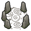
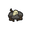
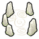
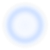

# Every building

Every building, piece of furniture and plant this mod adds.

## Buildings and furniture

| | Name | Value | What it is |
|---|---|---|---|
|  | **Balefire** |  | A sickly green fire that gives off no heat. It burns in the Wyrm's places and nowhere else. |
|  | **Caern** |  | A sacred place where the spirit world presses close. Garou near it get their Gnosis back fast, and rites performed here draw on its power. The Wyrm wants it destroyed. |
|  | **Granite wall** |  | Stone raised out of the earth by a Gift. It sinks back after four hours. |
|  | **Lingering tree** |  | The spirit of a tree cut down beyond the Gauntlet, lingering where it stood. A Garou can lay it to rest, and the nature spirits will remember it. |
|  | **Place of power** |  | A wild spot where the wall between the worlds feels thin. Cleanse it by rite, and a caern can be opened here. |
|  | **Shining caern** |  | The caern as the spirits see it: a place of blazing Gnosis, the heart of the sept's land. A Garou near it regains Gnosis. |
|  | **Shining place of power** |  | A place of power as the spirits see it, bright with the caern's Gnosis. |
|  | **Thin spot** |  | A place where the Gauntlet wears thin and the world beyond shows through. Stepping across is easier here, and possible even for a Garou with no Gnosis left. A Garou resting by it slowly regains Gnosis. |

[← Garou contents](README.md) · [The Rim by Night](../README.md)

---

This is not official World of Darkness material. Portions of the materials are the copyrights
and trademarks of Paradox Interactive AB, and are used with permission. All rights reserved. For
more information please visit worldofdarkness.com.
