# Every item

Every item, weapon and piece of apparel this mod adds. Value is the base market value in silver.

## Items

| | Name | Value | What it is |
|---|---|---|---|
| 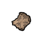 | **Apeskin** | 300 | A scrap of tattooed skin with a Homid ancestor bound in it. Woken, it lets its Garou live a day as one born human: silver is no worse than steel, but the wounds don't knit by themselves either. |
| 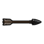 | **Bane arrow** | 160 | An obsidian-headed arrow with a war spirit in it. Woken, it flies at the nearest hostile spirit and never misses. |
|  | **Bane-glass** | 600 | A shard of smoked glass with a watcher spirit in it. Looked through, it shows the Umbra's edge for a day, banes and all. Three looks, and then it needs a point of Gnosis for each one more. |
| 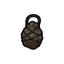 | **Baneskin** | 900 | A scrap of a bane wrapped in cloth and worn as an amulet. Woken, it makes the banes around take its Garou for one of their own. |
| 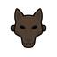 | **Beast mask** | 900 | A carved wolf mask with an animal spirit bound in it. Woken, it pulls its Garou into the wolf's shape and holds them there for an hour. |
|  | **Black Spiral's confession** | 2000 | A Black Spiral Dancer's account of the Labyrinth, written down before it died. It's ugly to read. A Garou who gets through it understands the Wyrm's ways better for it, and gains experience. |
| 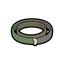 | **Chameleon skin** | 600 | A belt of lizard hide with a chameleon spirit bound in it. Woken, the Garou's fur takes the colors of the land around. |
| 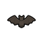 | **Chiropteran spy** | 240 | A wooden bat figurine with a bat spirit in it. Woken, it flies off to scout and shows every foe on the map before it turns to sawdust. |
|  | **Cup of the alicorn** | 600 | A carved, covered cup said to be unicorn horn. Any poison poured into it turns harmless. |
| 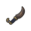 | **D'siah** | 1200 | A flint knife curved like a crescent moon, with a cobra spirit in the blade: the Silent Striders' own. Its cuts are aggravated, and woken after a strike it drinks the foe's Gnosis. |
| 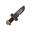 | **Dagger of retribution** | 800 | An ugly iron dagger with a vengeance spirit in it. Held and woken, it tugs toward whoever wronged its Garou. |
| 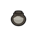 | **Death dust** | 240 | A small jar of dust with a spirit of death in it. Sprinkled on the newly dead, it lets them speak: what they knew is the Garou's. |
|  | **Dream stealer** | 600 | A many-colored gem with a dream spirit in it. Held near a sleeper and woken, it plays their dreams in its depths. |
| 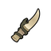 | **Fang dagger** | 1200 | A dagger carved from a great beast's tusk, with a snake spirit in it. Woken after a strike, it bites deeper into the wound. |
| 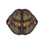 | **Feathered cloak** | 1200 | A full-length cloak of a thousand colored feathers with a bird spirit bound in it. Woken, it carries its wearer through the air. |
|  | **Fragment of the Silver Record** | 2000 | Pages copied from the Silver Record, the Garou Nation's history as the Galliards keep it. Between the tales are the words and motions of a rite. A Garou who reads it through learns the rite, if it's one they're ready for. |
| 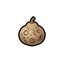 | **Gaia's breath** | 200 | A dried, glyph-painted gourd with a healing spirit in it. Crushed over a wound, it heals even aggravated wounds. |
| 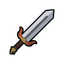 | **Grand klaive** | 2000 | An immense silver sword with a war spirit and a fire spirit bound in it: the klaive of a legendary hero. Its cuts are silver, and woken the fire spirit shields its Garou from flame. Carrying one dulls its Garou's Gnosis by two. |
| 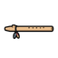 | **Harmony flute** | 300 | A hickory flute hung with songbird feathers. Its tune calls up memories of a whole world, and every angry creature that hears it stops fighting. |
|  | **Ice echo** |  | The Garou's own mirror image, scars on the wrong side. It moves and sounds like them, but has no scent, no warmth and no weight. |
| 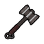 | **Ironhammer** | 1600 | A one-handed hammer of silver-laced iron with a war spirit in it: the Get of Fenris's own. Its blows are aggravated, and thrown it flies back to its Garou. |
| 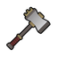 | **Jarlhammer** | 2000 | One of the seven great hammers of the Get of Fenris, silver-laced iron with spirits of war and silver in it. Its blows are silver, and woken it blazes with fire. |
| 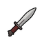 | **Klaive** | 1600 | A silver dagger with a war spirit bound in it, the signature weapon of the Garou. Its cuts are silver: no Garou soaks them. Carrying one dulls its Garou's Gnosis by one. |
| 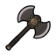 | **Labrys of Isthmene** | 1600 | A massive double-headed axe dedicated to Isthmene, the Gorgon of battle: the Black Furies' own. Its blows are aggravated, and woken it grants the Spirit of the Fray. It answers no male. |
| 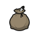 | **Magpie's swag** | 300 | A plain sack with a magpie spirit bound in it. It holds three times what it looks like it should. |
|  | **Mirrorshades** | 300 | Mirrored sunglasses with a glass elemental bound in them. A mirror always to hand: the Gauntlet is two lower to step sideways. |
| 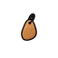 | **Monkey puzzle** | 1200 | An amber talisman holding one human hair, with a trickster spirit bound in it. Woken, people see an ordinary person, whatever form the Garou wears. |
| 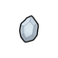 | **Moon glow** | 320 | A moonbeam caught in a crystal by a lune. Woken, it keeps its Garou safe on a journey through the spirit world: spirits ask no price and leave them be. |
| 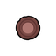 | **Moon sign** | 200 | A wax seal with the sign of the full moon and a lune in it. Thrown down before a Garou, it forces them into Lupus. |
|  | **Moon-tooth knife** | 900 | A knife ground from a wolf's tooth, with a Lune bound in it. Woken, it makes its bearer's blows bite deeper for two hours. The Lune wakes once, then sleeps until the next full moon. |
| 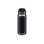 | **Nightshade** | 200 | A vial of night distilled. Drunk, it turns its drinker to shadow for an hour. |
|  | **Nyx's bangle** | 300 | A silver bracelet carved with glyphs to Luna and a night spirit bound in it. Woken, it hides its Garou in the shadows; only the eyes shine. |
|  | **Partridge wing** | 900 | A snow-white partridge wing on a gold chain, with a spirit of forgetting in it. Swept around someone in a circle, it sweeps away a memory, and with it their fear. |
|  | **Pathstone** | 300 | A smooth stone that hums faintly with the Umbra's paths. A ritemaster can spend it in the Rite of the Opened Bridge to join the caern to a sept's caern. |
|  | **Pattern spiders' web** |  | A machine or a wire as the Penumbra shows it: a thick, bright web that the pattern spiders keep spinning tighter. It clings to whoever walks through it. |
| 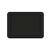 | **Personal Umbral Digital Application** | 1200 | A tablet with a bee spirit in its circuits: the Glass Walkers' own. Its hive of files keeps the Garou's notes and research in perfect order. |
|  | **Phantasm** |  | A barricade that looks, sounds and even feels real. It isn't. |
|  | **Phoebe's veil** | 900 | A small gold half-moon pendant with a lune bound in it. Woken at night, its wearer vanishes from every sense but touch, a minute a success. |
|  | **Pocket mirror** | 40 | A small mirror of polished steel. A Garou can stare into it to step sideways into the Penumbra, though it's harder than with still water. It works from the inventory: right-click it with a pawn selected to pick it up. |
| 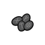 | **Rage-stone** | 400 | A red river stone that holds a little fury. Woken, it gives its bearer a point of Rage. It fills again under the moon its bearer was born under. |
|  | **Runestones** | 1500 | Carved divination stones with a spirit of time bound in them. Cast and woken, they show what is to come. |
| 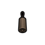 | **Sanctuary chimes** | 900 | A tiny tubular bell with a turtle spirit in it. Rung, its chimes keep hostile spirits away for a day. |
|  | **Shadow of suffering** |  | A grave, a corpse left unburied, a prisoner's cell or a broken mind, as the spirit world sees it: a cold shadow where banes come to feed. |
|  | **Spirit fruit** | 4 | Fruit grown in a Wyld glade of the Penumbra, faintly glowing. It feeds like any berry, and a Garou who eats it regains a point of Gnosis. |
| 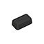 | **Spirit tracer** | 600 | A human hair set in an iron ingot with a predator spirit bound in it. Woken, the ingot pulls toward spirits. |
| 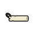 | **Spirit whistle** | 1200 | An ivory whistle with a screech-owl spirit in it. Its wail tears at every spirit in sight. |
| 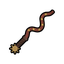 | **Sun whip** | 1200 | A bullwhip woven with gold nuggets, with a spirit of flame bound in it. Woken, it bursts into fire against whatever it strikes. |
|  | **Truth earring** | 300 | A small gold earring with a servant of Falcon in it. It trembles at every lie its wearer hears. |
|  | **Unbroken cord** | 1200 | A length of braided hemp cord with a flock spirit in it, enough for a whole pack. Woken, its Garou shares Gnosis with every packmate near. |
|  | **Weaver's web** |  | The spirit of something built, shown in the Penumbra as a faint outline of web. The Weaver spins over everything people make. |
| 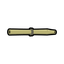 | **Wind snorkel** | 120 | A hollow reed with an air elemental in it. Through it, its Garou breathes anywhere: under water, in smoke or in poison. |
| 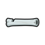 | **Wind whistle** | 900 | A whistle of bone with a wind elemental in it. One long blast calls a freezing, snow-laced wind on the Garou's pursuers. |
| 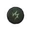 | **Wyrm scale** | 320 | A sigil with a captive Wyrm spirit in it. Woken, every servant of the Wyrm on the map shows its true form; then it burns up in green fire. |

[← Garou contents](README.md) · [The Rim by Night](../README.md)

---

This is not official World of Darkness material. Portions of the materials are the copyrights
and trademarks of Paradox Interactive AB, and are used with permission. All rights reserved. For
more information please visit worldofdarkness.com.
