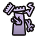

# Edges

Edges are the powers the Messengers give. Each Creed has a path of five, from level 1 to 5, and each
Edge belongs to the path's Virtue.

## Buying Edges

- A level costs its number in points of its Virtue: level 1 costs 1, level 3 costs 3.
- Edges go in order on a path. The next one on the hunter's own path comes first.
- Other paths open too, for any Virtue the hunter has points in, but never past the best Edge on
  their own path.
- Level 5 opens only at 10 in the primary Virtue, and only on the hunter's own path.
- When a new Virtue point makes an Edge affordable, the alert "Hunter can learn an Edge" shows on the
  right. Click it to jump to the hunter, then press Learn an Edge on the Imbued tab. Unspent points
  keep. A new Edge is ready at once.

Unspent points show under each Virtue on the Imbued tab, with a link to pick an Edge.

## Using them

Each path gets one tile on the gizmo bar. Click it, pick the Edge, then the target. Most Edges roll
an Attribute plus the Virtue against a difficulty, usually 6, and the successes set how strong or how
long it is. Some cost Conviction to start, shown in the tables below.

Edges that work on monsters do nothing to people or to other hunters.

## Risking Conviction

The tab's **Risking Conviction** row sets the hunter's habit:

| Setting | What happens |
|---|---|
| Never | No risk |
| When desperate | Risk 2 when hurt, outnumbered or outmatched |
| Always risk 2 | Risk 2 whenever possible |

Once an hour the next Edge roll takes the risked points as extra dice. A success keeps them and adds
one more. A failure loses them; a botch loses all the hunter's Conviction.

**Autocast** sets whether a hunter uses Edges on their own in a fight, as for Kindred and Garou.

## Every Edge

### Vengeance (Zeal)

| | Edge | Level | Conviction | Roll | Reach | What it does |
|---|---|---|---|---|---|---|
|  | **Cleave** | 1 | 0 | None | Self | The hunter's weapon, or a blade of nothing in her empty hand, cuts like it was made for the monsters. |
|  | **Trail** | 2 | 0 | Perception + Zeal at 6 | Touch | One touch and the hunter can follow a monster anywhere: she sees the track it leaves, and no one else does. |
|  | **Smolder** | 3 | 0 | Manipulation + Zeal at 7 | Self | Thick black smoke pours off the hunter, and anything shooting at her shoots blind. |
|  | **Surge** | 4 | 1 | None | Self | The hunter's fury runs into her body: stronger, faster, harder to put down. |
|  | **Smite** | 5 | 1 | Dexterity + Zeal at 6 | 24.9 cells | Something that isn't quite lightning and isn't quite fire leaps from the hunter, with a crash and a stink of ammonia. |

### Defense (Zeal)

| | Edge | Level | Conviction | Roll | Reach | What it does |
|---|---|---|---|---|---|---|
|  | **Ward** | 1 | 0 | Stamina + Zeal at 6 | Self | A crackling edge round the hunter that monsters can't push through unless their will is stronger than hers. |
|  | **Rejuvenate** | 2 | 0 | None | Touch | The hunter's body knits itself back together far faster than it should, and her hands can close another's wounds. |
|  | **Brand** | 3 | 0 | Zeal at 6 | Touch | The hunter's touch burns a mark into a monster that every hunter can see and no disguise hides. |
|  | **Champion** | 4 | 1 | Appearance + Zeal at 6 | Self | The hunter calls the monsters out, and they forget everyone but her. |
|  | **Burn** | 5 | 2 | Stamina + Zeal at 6 | Self | Something like molten rock runs under the hunter's skin. Touching her burns, and so does her touch. |

### Judgment (Zeal)

| | Edge | Level | Conviction | Roll | Reach | What it does |
|---|---|---|---|---|---|---|
|  | **Discern** | 1 | 0 | Perception + Zeal at 6 | Self | The hunter sees what a monster is: the dead that don't breathe, the beast under the skin, the blood-drinker's pallor. |
|  | **Burden** | 2 | 0 | Stamina + Zeal at Stamina + 3 | 24.9 cells | Under the hunter's stare a monster grows too heavy to move. |
|  | **Balance** | 3 | 0 | Wits + Zeal at Stamina + 2 | 24.9 cells | The hunter weighs a monster and finds it wanting. For a time, whatever powers it has won't answer. |
|  | **Pierce** | 4 | 0 | Perception + Zeal at 7 | Touch | The hunter knows a lie when she hears one, and with a touch she sees someone's last brush with a monster, or a monster's past. |
|  | **Expose** | 5 | 2 | Zeal at 8 | Self | For a moment everyone around the hunter sees the monsters as she does. |

### Innocence (Mercy)

| | Edge | Level | Conviction | Roll | Reach | What it does |
|---|---|---|---|---|---|---|
|  | **Hide** | 1 | 0 | Wits + Mercy at 6 | Self | Monsters look straight past the hunter, as if she weren't worth the trouble, until she makes them notice her. |
|  | **Illuminate** | 2 | 0 | Perception + Mercy at 6 | Self | The hunter blazes with a light only the imbued and the monsters can see. Every hunter near her knows the monsters for what they are, and every monster wants the light put out. |
|  | **Radiate** | 3 | 0 | Stamina + Mercy at 6 | Self | A white light wraps the hunter and those close to her, and the monsters' blows slide off it. |
|  | **Confront** | 4 | 1 | Manipulation + Mercy at 5 | 24.9 cells | The hunter meets a monster's eyes and stands there, and hurting her becomes the hardest thing it has ever tried to do. |
|  | **Blaze** | 5 | 2 | Strength + Mercy at 8 | Self | The nearest light flares into something no monster can stand, and burns every one of them in reach. |

### Martyrdom (Mercy)

| | Edge | Level | Conviction | Roll | Reach | What it does |
|---|---|---|---|---|---|---|
|  | **Demand** | 1 | 0 | None | Self | The hunter hurts herself to do what she couldn't, and the pain becomes strength. |
|  | **Witness** | 2 | 0 | Perception + Mercy at 6 | Self | The hunter sees the monsters for what they are, and glimpses the harm they've done. |
|  | **Ravage** | 3 | 0 | Manipulation + Mercy at 7 | 24.9 cells | The air shimmers with heat round one monster and it burns from the inside. The hunter pays for it in her own body. |
|  | **Donate** | 4 | 2 | None | Touch | The hunter lends part of herself to someone else: her strength, her quickness, her wits, for as long as she can spare them. |
|  | **Payback** | 5 | 5 | None | 24.9 cells | The hunter holds a monster's gaze and makes it pay: it's as frail as a person, or one of its powers is gone, for as long as she stays near. |

### Redemption (Mercy)

| | Edge | Level | Conviction | Roll | Reach | What it does |
|---|---|---|---|---|---|---|
|  | **Bluster** | 1 | 0 | Wits + Mercy at 6 | Self | One shouted word, "No!" or "Stop!", and the blow goes wide. |
|  | **Insinuate** | 2 | 0 | Manipulation + Mercy at 6 | 24.9 cells | One quiet question that reminds a monster of what it used to be. It falters, and sometimes it runs. |
|  | **Respire** | 3 | 0 | Stamina + Mercy at 6 | 24.9 cells | The hunter breathes life into someone hurt, or draws it out of a monster. |
|  | **Becalm** | 4 | 1 | Manipulation + Mercy at 7 | Self | A calm spreads out from the hunter. Fists slow, triggers wait, and rages burn out. |
|  | **Suspend** | 5 | 2 | Charisma + Mercy at 8 | Self | The hunter shuts this place off from every other world. Whatever is here stays here and answers for itself. |

### Vision (Vision)

| | Edge | Level | Conviction | Roll | Reach | What it does |
|---|---|---|---|---|---|---|
|  | **Foresee** | 1 | 0 | Intelligence + Vision at 7 | Self | A flash of how the next few moments could go, and the chance to choose the better one. |
|  | **Pinpoint** | 2 | 0 | Perception + Vision at 6 | 24.9 cells | The hunter looks at a monster and knows where it's weak. |
|  | **Delve** | 3 | 0 | Perception + Vision at 6 | Self | The hunter reads the recent past of the ground she stands on, and sees who walked there. |
|  | **Restore** | 4 | 3 | Stamina + Vision at 6 | Touch | The hunter pictures a body whole and it becomes so: deep wounds turn to bruises, and what was lost grows back. |
|  | **Augur** | 5 | 3 | Intelligence + Vision at 8 | Self | The hunter sees what's coming to this place, though the future doesn't always tell the truth. |

[← Imbued contents](README.md) · [The Rim by Night](../README.md)

---

This is not official World of Darkness material. Portions of the materials are the copyrights
and trademarks of Paradox Interactive AB, and are used with permission. All rights reserved. For
more information please visit worldofdarkness.com.
