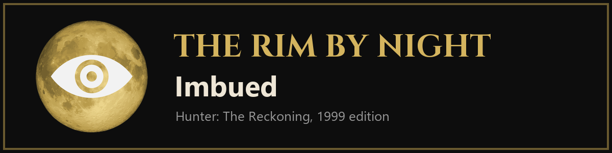

# The Rim by Night: Imbued

The Rim by Night: Imbued brings Hunter: The Reckoning (1999) to RimWorld. A colonist who watches a
monster hurt someone can be imbued: the voices called the Messengers wake them up, and from then on
they see monsters for what they are. They get a Creed, the three Virtues of Mercy, Vision and Zeal,
Conviction, and Edges to fight with.

The afflicted are the mod's own monsters, so it plays on its own. With The Rim by Night: Kindred
or Garou loaded, hunters go after vampires and werewolves too.

> **In development.** Balance will change and bugs are likely. Keep a backup of any save you add
> the mod to.

## New here?

1. [Getting started](Getting-Started.md): install, the scenarios, the first night.
2. [Being imbued](Being-Imbued.md): the Imbuing, second sight and Conviction.
3. [Menus and buttons](Interface.md): what everything on screen does.

## Contents

| Page | What's in it |
|---|---|
| [Getting started](Getting-Started.md) | Install, the three scenarios, how colonists get imbued mid-game |
| [Being imbued](Being-Imbued.md) | The Imbuing, Bystanders, Conviction, second sight, the cell |
| [Creeds and Virtues](Creeds-and-Virtues.md) | The seven Creeds, raising Virtues, deeds and betrayals, derangements |
| [Edges](Edges.md) | Buying Edges, risking Conviction, every Edge |
| [Character sheet](Character-Sheet.md) | Backgrounds, Awareness, Attributes, Willpower and experience |
| [The afflicted](The-Walking-Dead.md) | Shamblers, revenants, the hidden and the necromancer |
| [Investigation and lairs](Investigation-and-Lairs.md) | Clues, prowling visitors, town cases, talking to townsfolk, rewards, naming a monster, leads and lairs |
| [The table, the horror and the last stand](Hunter-Tools.md) | The autopsy table, files and notes, the first horror, bait, last stands, errands, sparing |
| [Captured monsters and the board](Captured-Monsters-and-the-Board.md) | Talking to a monster prisoner, redemption, letting it go on its word, the cells' notes on the Hunters' Board |
| [The other cells](Hunter-Net.md) | The other cells, warnings, calls for help, mentors, hunters in other bands |
| [The sworn cell](The-Sworn-Cell.md) | Throwing in with one cell, its imbued by name, roles and duties, the vote, enemies inside, war |
| [Living with monsters](Living-with-Monsters.md) | Vampire and Garou colonists, and what each Creed does about them |
| [Menus and buttons](Interface.md) | The Imbued tab, Edge tiles, letters |
| [Settings and FAQ](Settings-and-FAQ.md) | Mod settings, compatibility, common questions |

## Reference

Every event, power, item and the rest, listed in full from the game files.

| Page |
|---|
| [Every event](Reference-Events.md) |
| [Every mission and quest](Reference-Missions.md) |
| [Every power](Reference-Powers.md) |
| [Every item](Reference-Items.md) |
| [Every building](Reference-Buildings.md) |
| [People, factions and creatures](Reference-People.md) |
| [Every condition](Reference-Conditions.md) |
| [Every thought and mood](Reference-Thoughts.md) |
| [Mental states and inspirations](Reference-Minds.md) |
| [Learning tips](Reference-Tips.md) |
| [Every setting](Reference-Settings.md) |
| [Every alert](Reference-Alerts.md) |
| [What changed](Reference-Changes.md) |
| [Everything else](Reference-Other.md) |

---

This is not official World of Darkness material. Portions of the materials are the copyrights
and trademarks of Paradox Interactive AB, and are used with permission. All rights reserved. For
more information please visit worldofdarkness.com.
