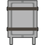

# Every building

Every building, piece of furniture and plant this mod adds.

## Buildings and furniture

| | Name | Value | What it is |
|---|---|---|---|
|  | **Autopsy table** |  | A steel table with a gutter and straps. Carry a downed monster, a staked vampire or a corpse here, then have a hunter or Bystander examine it, test it or take it apart. Nobody sleeps on it. |

[← Imbued contents](README.md) · [The Rim by Night](../README.md)

---

This is not official World of Darkness material. Portions of the materials are the copyrights
and trademarks of Paradox Interactive AB, and are used with permission. All rights reserved. For
more information please visit worldofdarkness.com.
