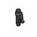
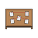
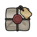
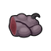
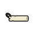

# Every item

Every item, weapon and piece of apparel this mod adds. Value is the base market value in silver.

## Items

| | Name | Value | What it is |
|---|---|---|---|
|  | **Bait stake** |  | A post with a rope and a hook. Bind a live animal or a corpse to it, and the next group of monsters on the map goes for the body before anything else. Ordinary raiders ignore it, and it doesn't call anything or bring a threat sooner. |
|  | **Claw marks** |  | Wounds no animal of this size could leave, on someone torn apart. A hunter or a Bystander can examine them for who did it. |
|  | **Dead cell's casebook** | 2000 | Everything a cell learned before it went quiet: cases, the things behind them, what worked and what got people killed. An imbued who reads it through hunts better for it. |
|  | **Dead hunter's notebook** | 150 | The notebook of a hunter who didn't come back. Read through, it gives one clue on an open case: what kind of thing did it, or one person it wasn't. Then the rest is just the hunter's last days. |
|  | **Disturbed ground** |  | Where a body lay, the ground is clawed and churned, as if it got up and walked away. Something brought it back. A hunter or a Bystander can examine it. |
|  | **Fang marks** |  | Two small punctures on the throat of someone drained to death. A hunter or a Bystander can examine them for who did it. |
|  | **Hangman's rope** | 400 | Rope from a gallows that hanged a guilty man. Thrown over a monster, it holds it like a net. It holds two, then needs a week to get its grip back. |
|  | **Hidden things** |  | What someone keeps hidden among their things: a bottle of blood, coarse grey hair, a black ooze, grave dirt. A hunter or a Bystander can examine it. |
|  | **Hunter's notes** | 10 | Pages of what the table has shown: what each kind of monster is, what hurts it and how to hit it. The colony's blows follow the most complete copy on a home map. Keep a copy somewhere safe, because if every copy burns the colony forgets it all. |
|  | **Hunters' Board** |  | A cork board where the hunters pin what they need to see: newspaper clippings with string between them, one for every monster tracked down in a town and put down, and the notes other cells leave. Seeing it lifts the mood of everyone in the colony, more with each case solved. Look at it to read what's pinned there. |
|  | **Keepsake** | 60 | Something taken from a monster the hunters put down, kept to remember the case by. |
|  | **Knotted rope** | 60 | A short length of hemp rope, frayed at one end and tied in a hangman's knot at the other. Study it at a case board or a research bench to find out what it is, or let a hunter with second sight look at it. |
|  | **Marked spot** |  | The Messengers want a hunter here before dusk. Nobody can say what for. Ignore it and it fades. |
|  | **Piece of a horror** | 1 | A piece cut from the monster that made a hunter. It doesn't rot, which is the worst thing about it. Study it on the autopsy table and the colony hits that monster harder. |
|  | **Saint's knucklebone** | 500 | A bone from a holy man's hand. Carried, it breaks a monster's hold on its bearer's mind once a day: a frenzy, a fear or a madness that no mood caused ends on the spot. |
|  | **Strange blood** |  | Blood from a wound, too dark or too thick to be a person's. A hunter or a Bystander can examine it. |
|  | **Taint** |  | A greasy black residue that smells of rot and chemicals, left where something used a power. A hunter or a Bystander can examine it. |
|  | **Torn carcass** |  | An animal killed in the night, torn open and left where it fell. Nothing that lives here hunts like that. A hunter or a Bystander can examine it. |
|  | **Tracks** |  | Bare footprints, walking slowly round and round someone's bed, where nobody should have been in the night. A hunter or a Bystander can examine them. |
|  | **Tracks that stop** |  | Footprints that end in the middle of open ground, as if whoever made them stepped out of the world. A hunter or a Bystander can examine them. |
|  | **Water-stained notebook** | 60 | A pocket notebook swollen with damp, its pages stuck together. Study it at a case board or a research bench to find out what it is, or let a hunter with second sight look at it. |
|  | **Witness's account** |  | Someone saw something here they can't explain and couldn't keep quiet about it: a few lines dropped on a scrap of paper, a description that doesn't sound human. A hunter or a Bystander can examine it. |
|  | **Yellowed knucklebone** | 60 | A finger bone, smooth from handling, wrapped in a strip of old cloth. Study it at a case board or a research bench to find out what it is, or let a hunter with second sight look at it. |

[← Imbued contents](README.md) · [The Rim by Night](../README.md)

---

This is not official World of Darkness material. Portions of the materials are the copyrights
and trademarks of Paradox Interactive AB, and are used with permission. All rights reserved. For
more information please visit worldofdarkness.com.
