# Every building

Every building, piece of furniture and plant this mod adds.

## Buildings and furniture

| | Name | Value | What it is |
|---|---|---|---|
| 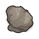 | **Blood cocoon** |  | A hard white shell of dried blood and fluids, the size of a person. Something inside it shifts now and then. |
| 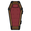 | **Coffin** |  | A long box with a lid that shuts tight. A vampire sleeping inside is safe from the sun even without a roof overhead. Anyone can sleep in one. |
| 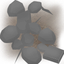 | **Disturbed earth** |  | A patch of freshly turned soil. Something is lying under it. |
| 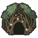 | **Dome of branches** |  | A dome of branches, leaves and vines grown tight together. A stranger can't find a way in. Something sits inside it. |
|  | **Figure in the stone** |  | A grey figure with a gargoyle's skin, standing half sunk into the rock. |
| 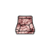 | **Flesh armchair** |  | A chair grown out of a living person. Their skin is the upholstery and their ribs are the frame, and it's warm to sit in.  They're still in there. They don't age or need food. A vampire with Fleshcraft can shape them back into a person. If it's broken apart, they fall out downed; destroyed any other way, they die. |
| 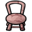 | **Flesh chair** |  | A dining chair grown out of a living person, folded at the waist with the back held straight.  They're still in there. They don't age or need food. A vampire with Fleshcraft can shape them back into a person. If it's broken apart, they fall out downed; destroyed any other way, they die. |
| 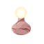 | **Flesh lamp** |  | A lamp grown out of a living person, drawn up tall and thin. A dim red light shows through the stretched skin, and it never needs fuel or power.  They're still in there. They don't age or need food. A vampire with Fleshcraft can shape them back into a person. If it's broken apart, they fall out downed; destroyed any other way, they die. |
| 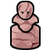 | **Flesh sculpture** |  | A living person worked into a twisting knot of limbs and faces, made to be looked at. Kindred call it art.  They're still in there. They don't age or need food. A vampire with Fleshcraft can shape them back into a person. If it's broken apart, they fall out downed; destroyed any other way, they die. |
| 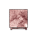 | **Flesh table** |  | A table grown out of a living person, on all fours with the back spread flat and wide. People eat off it.  They're still in there. They don't age or need food. A vampire with Fleshcraft can shape them back into a person. If it's broken apart, they fall out downed; destroyed any other way, they die. |
|  | **Heap of ash** |  | A heap of sticky white ash, damp to the touch. It stirs now and then. |
| 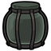 | **Heart vessel** |  | A sealed jar of thick glass in a metal cage, made to hold a vampire's heart once Serpentis has taken it out. A heart kept in it can't be burned, cut or shot while the vessel stands. Hunters and enemy Kindred who know what is inside will try to break it open. |
|  | **Molten rock** |  | Glowing rock welling out of the ground. Anything that touches it burns. |
| 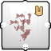 | **Ossuary altar** |  | A low platform of stone, wood or metal laid with old bones in careful patterns. Necromancy rituals of the third level and above are worked standing on it, and necromancers teach their rituals here. |
|  | **Persistent echo** |  | A faint shimmer in the air, and a sound just too quiet to hear. Enemies who step into it hear it all at once. |
| 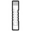 | **Pillar of Osiris** |  | A place made holy by long meditation. Those who know the discipline of Bardo find their minds clear and their Beasts quiet here. |
| 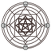 | **Ritual circle** |  | A circle of stone, wood or metal inlaid with silver and marked with occult signs. Blood magic of the third level and above is worked standing inside it, and rituals are taught here. |
|  | **Scorpion's Curse** |  | A blood ward on the ground. The first enemy to touch it takes the Assamites' poison. |
| 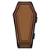 | **Sealed coffin** |  | An old coffin, its lid fixed down long ago. Something lies inside. Whatever it is has waited a long time and may not take kindly to being woken. |
|  | **Shape under the water** |  | Something lies still just under the surface. From some angles it looks like a sleeper. |
|  | **Wall of water** |  | Water standing straight up out of nowhere, as solid as a wall. It will fall at dawn. |

[← Kindred contents](README.md) · [The Rim by Night](../README.md)

---

This is not official World of Darkness material. Portions of the materials are the copyrights
and trademarks of Paradox Interactive AB, and are used with permission. All rights reserved. For
more information please visit worldofdarkness.com.
