# Every item

Every item, weapon and piece of apparel this mod adds. Value is the base market value in silver.

## Weapons

| | Name | Damage | Value | What it is |
|---|---|---|---|---|
| 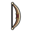 | **Ivory Bow** | 15 ivory arrow, range 25.9 | 1800 | A bow of rowan and ash backed with carved ivory. Its arrows wound vampires the way fire does, and the wounds heal as slowly. The ivory is old and cracks with use. |
| 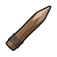 | **Wooden stake** | 10 melee | 8 | A sharpened length of wood. Driven through a vampire's heart, it holds the body rigid until someone pulls it out.  It can be used as a weapon. Against the living it's a poor knife. A thrust that finds a vampire's heart sometimes stays there. |

## Apparel

| | Name | Value | What it is |
|---|---|---|---|
| 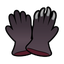 | **Black Gloves** | 1500 | Black velvet gloves that grow steel claws when their wearer wants a fight, ghoul or mortal or Kindred. Claws are hard to explain to anyone watching. |
|  | **Cracked Lens** | 900 | A pair of spectacles with one lens cracked in a starburst. The world through it looks a little wrong, and its wearer sees patterns others miss. A Malkavian who wears it gets only true warnings of coming danger. |
| 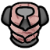 | **Fleshcrafted armour** | 120 | A shell of hardened flesh and bone plates, grown together from a corpse by Vicissitude. It turns blades and blows well. It is also unmistakably made of a person, and any mortal who sees it worn knows something is very wrong. |
| 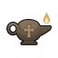 | **Lamp of Constantine** | 2500 | A small bronze oil lamp whose flame never needs feeding. Its light is the sun's. Kindred within a few strides burn and may flee in terror, and any who stay in its light for long, even from further off, fall into the sleep that comes before dawn. Mortals in it feel steadier. Hunters prize it above anything. A vampire who carries it burns too. |
|  | **Martinelli's Ring of Clear Thought** | 1800 | A gold ring made for a Malkavian elder who wanted, now and then, to think straight. While it is worn, no derangement can surface. Taking it off lets them all back in at once and worse than before, and the wearer can think of nothing but getting it back. |
|  | **Monocle of Clarity** | 900 | A Tremere-ground lens in a silver rim, made long ago to find Nosferatu hiding in plain sight. For a blood point and a hard look through it, the wearer sees through Obfuscate and Chimerstry as only the oldest Auspex can, and may glimpse other hidden things, the dead among them. Some of what it shows is not meant to be seen. |
| 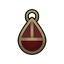 | **Personal talisman** | 50 | An object bound to one sorcerer by Thaumaturgy. Worn by its maker once it has settled, it strengthens their blood magic and holds a little of their blood. To anyone else it's a trinket. |
|  | **Philosopher's Ring** | 900 | A heavy silver ring engraved with lines from an argument nobody won. It steadies whoever wears it a little. A Brujah who wears it can call on Willpower to hold back frenzy, as the clan's blood usually won't allow. |
| 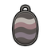 | **Phylactery of Recorded Memory** | 2000 | A banded granite amulet hung at the belt, holding the memories of everyone who wore it before. A new wearer gains a share of their skills, and a vampire a share of their occult lore. Not all of those memories were human, and the strangest can crack a mind. |
|  | **Pyramid Seal** | 1000 | A gold signet ring cut with the mark of the Tremere Pyramid. Anyone who wears it has an easier time with occult matters. A Tremere who wears it works rituals with two more dice and doesn't bond as easily as the clan usually does. |
|  | **Rowan Ring** | 800 | A plain ring of rowan wood. In a fight it lengthens into a stake on its wearer's finger, and a lucky thrust can find a vampire's heart. Nobody searching for weapons gives it a second look. It is only wood, and it wears out. |
| 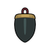 | **Scale of Apep** | 900 | A single black scale the size of a palm, hung from a cord at the waist. Its wearer moves with a snake's quickness. A Follower of Set who wears it is no longer troubled by bright light. |
| 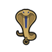 | **Uraeus of Osiris** | 3500 | A golden serpent with lapis eyes, worn at the belt. It once sat on Osiris's crown. Its bearer can see the dead without Necromancy, and by burning the body of a mortal sacrifice can open a way into the Egyptian lands of the dead. The dead notice in return: once a season something may follow the bearer home. |
|  | **Vestment of Vileness** | 2500 | A priest's robe, stained and heavy, with a blessing and a curse on it. It lends its wearer the Sepulchre Path's first four powers, but only if they know no Necromancy of their own. Anyone the wearer loves who comes close enough to touch is doomed to waste away. |
| 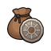 | **Wanderer's Coin** | 900 | A worn coin from no country anyone can name, kept in a pouch at the belt. Once a day it turns a vampire's failed roll into another try. A Ravnos who carries it finds the clan's vice a little easier to resist. |
| 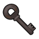 | **Warren Key** | 900 | An iron key, black with age, hung at the belt, said to open every door under the old cities. Its bearer digs and tunnels better. A Nosferatu who carries it spends one less blood on Obfuscate. |
| 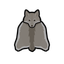 | **Wolf-mother's Pelt** | 1100 | The pelt of an enormous grey wolf, worn as a cloak. It is warm and turns blows like good leather armour. A Gangrel who wears it takes the shape of the wolf without spending blood. |

## Items

| | Name | Value | What it is |
|---|---|---|---|
| 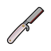 | **Aaron's Feeding Razor** | 1200 | A pearl-handled razor made by a Malkavian who couldn't bear the touch of his prey. A vampire carrying it feeds from a thin cut at arm's length: quicker, with no Kiss, and it looks like an ordinary wound. It finds its way to the purest blood, people who have never had a lover, before anyone else's. As a weapon it is small, and its cuts are aggravated. |
|  | **Abyssal Mirror** | 1000 | A tall mirror in a black frame that shows nothing at all, not even the room. Nobody likes it in the house. A Lasombra on the same map spends one less blood on Obtenebration. |
| 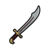 | **Ainkurn** | 2800 | A curved Turkish blade, sister to the Sword of Dracula. Each cut drinks from its victim straight into a vampire wielder's veins. Its owners want it back as much as the other. |
|  | **Blood vial** | 25 | A sealed vial of human blood, drawn at a medical bed. A vampire can drink it, though it satisfies less than blood taken fresh. A vial keeps something of its donor: how good the blood is, and any drug or sickness in it. It spoils within days unless frozen. |
|  | **Blood wine** | 60 | Fine blood, aged and sealed in a bottle the way a vintner keeps wine. A vampire drinks it for the pleasure as much as the vitae, and it keeps for a month without a freezer. |
| 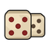 | **Bloodspot Dice** | 1000 | A pair of yellowed bone dice spotted with old blood. Carried by a vampire, they turn its failures into successes, and every win turns one of the forty-two spots red. With every spot red they stop winning, until someone's throat is cut and the dice are washed in the blood. |
|  | **Book of Lasombra poetry** | 2000 | Verses by a Lasombra of the old Spanish courts, about the dark that answers when called. Under the poems is a working guide to it. A reader who already commands the Abyss learns more of Obtenebration. |
| 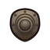 | **Brass Heart Shield** | 1200 | A curved plate of engraved brass made to sit over a vampire's heart under the ribs. No ordinary stake gets through it. Stakes made by ritual still find a way. It is heavy and the body never forgets it is there. |
|  | **Chalice of Kinship** | 2500 | A black chalice with no maker's mark. Packs who share the Vaulderie from it hold together like family, for better or worse. |
|  | **Clan history** | 200 | One clan's history as its own members tell it, flattering where it can be. Any vampire learns from it, and a vampire of that clan learns twice as much. |
|  | **Codex Caecitus** | 2500 | A huge book locked with iron, its pages in a cipher about the dead. Kept in a haven, it gives up a Necromancy ritual written out plain once a season. The Giovanni send people to take it back. |
|  | **Concoction of Vitality** | 1500 | A stoppered vial of something that smells of crushed grass and iron. A vampire who drinks it turns mortal over the next few hours and stays so for a day: the sun can't burn it and it needs no sleep, but it has no Disciplines at all and a killing blow kills it for good. Only one dose was ever known. |
| 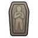 | **Enosch Sarcophagus** | 5000 | A sealed stone coffin carved with figures nobody can name, believed to hold a vampire of the second or third generation. It has never been opened and can't be. Keeping it raises the colony in the eyes of its sect, and draws rogues who want it for themselves. |
|  | **Erciyes Fragments** | 700 | Clay and parchment copies of the oldest known passages of the Book of Nod, found in a buried city. Hard going even for a learned vampire, and some of it should not be read too closely. It hints at where old things lie. |
|  | **Eye of Hazimel** | 4000 | A living eye, wet and watchful, said to have belonged to a Ravnos of terrible age. Set into an empty socket it sees better than any eye, shows a vampire host visions of what is coming, and lends the powers to bend sight and flesh. It also changes whoever carries it, a little at a time, and never for the better. |
| 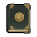 | **Family Ledger** | 900 | A thick, old account book of the Giovanni, every page a debt owed by someone living or dead. Kept in a Giovanni's haven, it makes the dead more willing to listen: one more die on Necromancy powers for a Giovanni on the same map. |
| 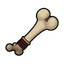 | **Femur of Toomler** | 2000 | A massive thigh bone, polished by handling, said to come from a Tzimisce elder of the fourth generation. Its blows wound vampires as fire does. The Tzimisce would like it back. |
|  | **Fragment of the Book of Nod** | 250 | Loose pages copied and recopied from the Book of Nod, the Kindred's oldest scripture. Vampires read them for what they say about Caine, the first generations and the end of nights. A Kindred reader gains experience, may hear of Golconda, and now and then recognises a relic from its pages. |
|  | **Hand of Conrad** | 2500 | A mummified hand, still supple, said to have belonged to a mighty Brujah. Grafted onto a wrist in place of the hand that was there, it is stronger than any hand should be, hits harder, and brings some of its owner's nerve with it. There are stories that it can raise the dead, which nobody believes. |
|  | **Hand of glory** | 30 | A dead hand made into a candle by a Necromancy ritual. Light it and every outsider asleep nearby stays asleep for hours. |
| 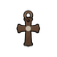 | **Holy symbol** | 20 | A carved symbol of faith, small enough to carry. In most hands it's only a keepsake. Carried by someone of strong True Faith, it burns the Kindred they strike with wounds that heal like fire. |
|  | **Hunter's journal** | 150 | A hunter's notebook: sightings, mistakes and what worked against the things they hunted. A Kindred reader learns what hunters look for. A mortal reader may come away believing, and belief is how True Faith starts. One taken from a hunter who came here may say which breach of the Masquerade led them to the colony. |
|  | **Illusory figure** |  | A figure that looks real from any distance. It isn't there. |
| 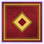 | **Illusory splendour** |  | Gilt, velvet, candlelight and fresh flowers, laid over whatever is really there. The room looks and smells like a palace, and feels like one to anyone who doesn't touch the walls. |
| 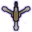 | **Illusory turret** |  | A gun emplacement that draws every eye and every shot. It never fires. |
| 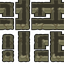 | **Illusory wall** |  | A stretch of wall that looks solid enough to stop anything. Nobody can see through it, but anyone who touches it may find their hand goes in. |
|  | **Inquisition record** | 250 | Records of a hunting order: names, sightings and suspected havens. Reading what the hunters know about this colony shows where the colony has been careless and lowers the breach of the Masquerade a little. |
| 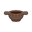 | **Jorum of Kinsmanship** | 2500 | A bowl of dark carved wood, stained from the inside. Everyone who shares a Vaulderie poured into it comes away bound to the others as tightly as the Vinculum goes. |
|  | **Koldun's book of the land** | 350 | A koldun's book, part prayer and part instruction, on drawing power out of earth, wind, water and fire. A Tzimisce who reads it through can learn the Ways without a teacher. To anyone else it is strange poetry. |
| 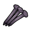 | **Nails of Dismus** | 400 | Long nails of a metal nobody can name. Driven into a vampire's heart, by surgery or by hand, one stakes like wood and drains the staked of Willpower at every dawn, as nightmares that never stop fill the sleep. The spirit tied to them doesn't like being disturbed. |
|  | **Necromantic ledger** | 300 | A Giovanni ledger that mixes the family's accounts with one Necromancy ritual written out in full. A necromancer strong enough in the art learns the ritual by reading it. Better copies hold harder rituals. |
|  | **Path primer** | 350 | A short book that sets out one Path of Enlightenment: its beliefs, its hierarchy of sins and what its followers must give up. A vampire who has fallen far enough from Humanity can take it in place of a mentor and begin a season of study. |
| 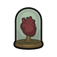 | **Pumping Heart of Nizchetus** | 1100 | A heart in a jar of green glass, still beating after centuries. Set down in the room where its owner sleeps, it brings them luck: every roll they make is a little easier. Nobody likes sharing a room with it. |
| 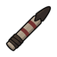 | **Quiescent stake** | 40 | A stake carved under a Thaumaturgy ritual. Wound a vampire with it and the tip breaks off and works its way to the heart over a few hours. The rest of the stake crumbles. |
| 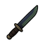 | **Quietus blade** | 90 | A knife with a dark sheen to the steel, treated with Assamite blood venom. Its next few hits carry aggravated venom whoever holds it. When the venom is spent it is an ordinary knife. |
|  | **Ravnos Chronicle** | 2000 | A Ravnos family's history, every page a story and half of them lies. Read closely, the lies are lessons in Chimerstry, for a reader who already has it. |
| 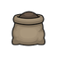 | **Sack of earth** | 1 | A sack of earth dug from this place. To a Tzimisce Embraced here it is home, and it has to be close by when they sleep. |
|  | **Sargon Fragment** | 3000 | A charred scroll in a lead case, said to be the work of the founder of the Cappadocians and to hint at a rite for becoming something more than Kindred. It is written in old Chaldean and makes no sense to anyone short of mastery in blood sorcery or Necromancy. A vampire who can work through it learns a Necromancy ritual and much about the occult. Many who have read it were never quite right after. |
|  | **Saulot's travelogue** | 2000 | A traveller's journal said to be copied from Saulot's own, from his years in the East. Between the roads and the cities are notes on healing and on the third eye's two paths, the Warrior's and the Healer's. A Salubri, or anyone who has learned their arts, can learn from it. |
| 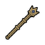 | **Sceptre of Lineage** | 1200 | A short gilded sceptre topped with a Ventrue crest. It hits like a club and lends its holder an air of command. In a Ventrue's hand, every contested mental power gets a die more. |
| 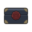 | **Sealed casket** | 0 | A small lacquered box, sealed with wax and a Prince's mark. Whatever is inside is none of your business. |
|  | **Skull of Saulot** | 4000 | A smooth old skull in a silver cage, said to be what remains of the Salubri founder after his killers were done. Thaumaturgy worked in the same room is stronger. Nobody who keeps it sleeps well for long. |
| 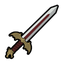 | **Sword of Dracula** | 3000 | An ornate broadsword etched with eastern letters and older signs, made to kill a demon. Its wounds are aggravated to anyone, and it drinks every cut it makes: the blade darkens from silver to red, and the blood stays fresh inside until a vampire wielder draws it out through the hilt. Those who think it belongs to them never stop looking for it. |
| 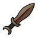 | **Sword of Nul** | 2000 | A bronze short sword older than writing, said to have been forged by a demon for a vampire of the First City. Every cut it makes drinks: the victim bleeds out faster and a vampire who wields it is fed. The Beast likes it too. A Kindred wielder has to fight off frenzy each time it drinks. |
|  | **Tablet of Destiny** | 3500 | Clay tablets of laws that legend ties to the First City. Very hard to read, and worth it: a vampire who masters them gains a great deal of experience and can take up the Path of Caine with no mentor, once it has fallen far enough from Humanity. |
| 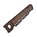 | **Talbot's Saw** | 1500 | A two-handed bone saw, rusted brown, once owned by a Gangrel killer. Its teeth have never dulled. It tears through anything, and the stories say whoever carries it can't be shot, cut or burned. That isn't quite true, but bullets, blades and fire do only half the harm they should. |
|  | **Tapestry of the Blood** | 3500 | A vast old tapestry of tangled threads that seem to move when nobody looks straight at them. Soaked in ten points of a vampire's blood and watched for a whole night, it shows scenes of the Kindred past, present and future: who the strangers nearby really are, courts nobody has mentioned, the places where elders sleep. What it shows can break a mind. The Tremere want it badly. |
|  | **Thaumaturgic grimoire** | 300 | A Tremere working book with one ritual of Thaumaturgy written out in full: the words, the signs and what has to be bled. A sorcerer who reads it and is strong enough in the art learns the ritual. Better copies hold harder rituals. |
|  | **Treatise** | 150 | A vampire's notes on one Discipline: what it learned, what went wrong, what it would tell a younger Kindred. A reader who already has the Discipline, at fewer dots than the writer had, learns from it. To anyone else it is a strange book. |
|  | **True Vessel** | 4000 | A plain clay jar that the Giovanni say was made to hold their founder's blood and soul. Whoever holds it has leverage over the family, which the sect values and the family does not forgive. |
| 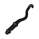 | **Tyrant's Lash** | 2200 | A plain horse whip with a small barb at the tip, made by a Tzimisce sorcerer for those who rule. In the hand of a vampire on the Path of Power and the Inner Voice, every stroke makes the one it cuts feel small and helpless: those who can't stand up to it fall to their knees, and a few never get all of their will back. In anyone else's hand it is just a whip. |
|  | **Unfinished Masterpiece** | 2500 | A painting its Toreador maker never finished, and the most beautiful thing many people will ever see. A Toreador on the same map can look at it without being entranced. It restores Willpower each night and keeps the clan's fascination with other works away. |
| 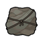 | **Unidentified relic** | 300 | Something old, wrapped in rotten cloth, that feels wrong to hold. Nobody here knows what it is. It can be examined at a ritual circle or ossuary altar, or picked up and used blind, which is a risk. |
| 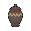 | **Urn of the Old Country** | 900 | A clay urn of earth sealed with wax, the soil of a place long gone. On a map with it, a Tzimisce rests as if on native soil, and the earth inside never runs out. |
| 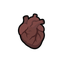 | **Vampire's heart** | 10 | A shrivelled heart that still beats, very slowly, outside its body. Its vampire can't be staked while it is away, and meets Final Death if it is destroyed. |
| 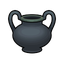 | **Venetian Jar** | 2000 | A black Roman funeral jar dug up in Venice, cold to the touch. Once a season someone can reach the dead through it. With a body laid beside it and a vampire's blood poured in, it calls that soul back into the flesh; otherwise the dead answer questions about where old things sleep or where courts meet. Sometimes one of the dead follows the question back. |
| 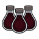 | **Vial of Kindred vitae** | 120 | A stoppered vial of vampire blood from the ghoul trade. Nobody will say whose it was. A vampire who drinks it takes no bond from a stranger, but Kindred blood is easy to get a taste for. |
| 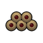 | **Vitae focus** | 15 | A small gold bead with a point of vampire blood sealed inside by Thaumaturgy. A vampire who crushes it drinks the blood back. |
| 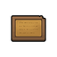 | **Waxen Poetica** | 1500 | A small wax tablet with verses scratched into it. Washed in blood and thrown, it latches on and spreads: after a few seconds the wax burns, worse every moment, and once it covers someone they can't move, and a mortal can't breathe. It comes off only if it cools by itself. One use. |

[← Kindred contents](README.md) · [The Rim by Night](../README.md)

---

This is not official World of Darkness material. Portions of the materials are the copyrights
and trademarks of Paradox Interactive AB, and are used with permission. All rights reserved. For
more information please visit worldofdarkness.com.
